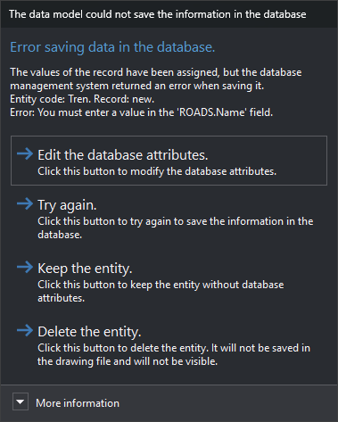

# Error saving data in the database
<!-- id: error-al-almacenar-datos-en-la-base-de-datos -->
<!-- origen: ca6b50093fa2efa32fa810c550572aea427f63e3 -->

Digi3D.AI displays “The database model could not save the information in the database” when the database management system rejects the record for one of an entity's codes. It appears when registering a new entity in a drawing file connected to a database and when clicking **OK** in [Edit codes](../ventana-de-dibujo/ordenes/e/editar-cod.md).

The error occurs at one of these steps:

* Reading the record already linked to the code.
* Creating a new record in the table.
* Saving the record after assigning all field values. For example, the record supplies no value for a non-nullable column, or a duplicate value for a unique column.
* Reading the newly created record's identifier.

If assigning a particular field value fails, Digi3D.AI instead displays [Error in user attributes](error-en-los-atributos-de-usuario.md).

## Contents

* **Main instruction**: the step where the error occurred.
* **Text**: entity code and database record. If saving the record fails, it also includes the database management system's error description, which usually names the column that rejected the value. The record appears as “new” if the code has no linked record yet.
* **More information**: module that generated the error, table, hexadecimal error code, message, source and error description returned by the database management system.

## Buttons

* **Edit the database attributes.**: opens [Edit codes](../ventana-de-dibujo/ordenes/e/editar-cod.md) with the failed code. Closing it with either **OK** or **Cancel** makes Digi3D.AI try to store the code again. If the error recurs, this dialog appears again.
* **Attempt again.**: tries to store the code again with the same values. Useful when the cause has been corrected outside Digi3D.AI, for example in the database itself.
* **Preserve entity.**: saves the entity in the drawing file. The failed code has no database record.
* **Delete entity.**: discards the entity. It is neither saved in the drawing file nor displayed.

If this dialog appears after clicking **OK** in Edit codes, **Preserve entity.** and **Delete entity.** only close this dialog: the entity is not deleted and retains the editor's changes, and codes after the failed code are not stored in the database.
