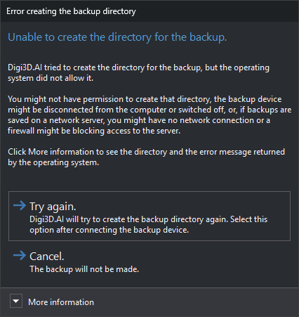
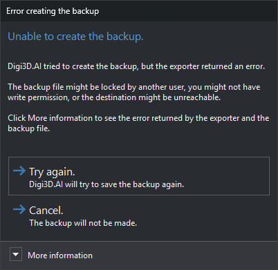

# Error creating the backup directory
<!-- id: error-al-crear-el-directorio-de-la-copia-de-seguridad -->
<!-- origen: 135134fb8f0f7e0ee3d0f7204014fb8932ead336 -->

Before making a backup, Digi3D.AI creates the destination directory if it does not exist. The backup file path comes from [Backup destination](configuracion/copia-de-seguridad/destino-de-copias-de-seguridad.md) or, when backing up during compression, [Backup destination when compressing](configuracion/copia-de-seguridad/destino-de-copias-de-seguridad-al-comprimir.md). Digi3D.AI displays this dialog when the operating system prevents creating that directory.

The dialog appears with [BAK](../ventana-de-dibujo/ordenes/b/bak.md), automatic backups made at intervals, and backups made on exit or compression.

## Contents

* **More information**: operating system error message and directory Digi3D.AI attempted to create.

## Buttons

The dialog has no close button. Esc is equivalent to **Cancel.**.

* **Attempt again.**: tries to create the directory again. If it fails again, the dialog reappears. Use after connecting the backup device or restoring network access.
* **Cancel.**: no backup is made.

## Unable to create backup

If the directory exists or has been created, Digi3D.AI writes the backup. If the drawing file format exporter returns an error, Digi3D.AI displays **Unable to create backup.**, with the window title **Error when creating backup**. This dialog behaves in the same way:

* **More information**: exporter error message and backup file path.
* **Try again.**: tries writing the backup again. If it fails again, the dialog reappears.
* **Cancel.** (or Esc): no backup is made.
