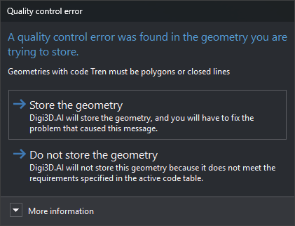

# Quality control error
<!-- id: error-de-control-de-calidad -->
<!-- origen: bb96b734f29840d26586c5c943886d076b050815 -->

Digi3D.AI displays this dialog after digitizing a geometry when one of its code's quality controls detects an error in the geometry or its relationship with other geometries. Analysis runs if [QUALITY\_CONTROL\_ON\_ENTITY\_END](../ventana-de-dibujo/variables/c/control-calidad.md) is enabled and the code's **Analyze quality control when digitizing** property is **Yes** in the [code table](../editor-de-tablas-de-codigos/pestanas/codigos/propiedades-del-codigo.md#quality-control).

If quality controls return several errors, the dialog appears once and shows them all, one per line. Warnings do not open this dialog: Digi3D.AI displays them in a balloon and stores the geometry.

## Contents

* **Text**: error message returned by the quality control, or all error messages, one per line. In the screenshot: “Geometries with code Tren must be polygons or closed lines”.
* **More information**: explains that quality control analysis is enabled and can be disabled with **QUALITY\_CONTROL\_ON\_ENTITY\_END** or **Quality control/Analyze quality control when an entity is finished**.

## Buttons

The dialog has no close button: you must choose one of these buttons.

* **Store the geometry**: stores the geometry with the error. If the quality control supplies error coordinates (with several errors, those of the first error supplying coordinates), the drawing window moves there and, if [GOTO\_SNAP](../ventana-de-dibujo/variables/i/ir_tentativo.md) is enabled, the cursor moves to that point.
* **Do not store the geometry**: discards the geometry, removes it from the screen, plays the error sound and displays the quality control message in a balloon.
