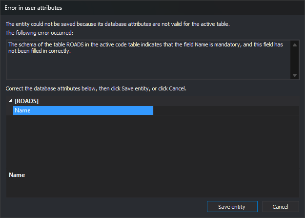

# Error in user attributes
<!-- id: error-en-los-atributos-de-usuario -->
<!-- origen: bbb39f270aaff19056bf67e0b02bf8949178c6d0 -->

Digi3D.AI displays this dialog when it cannot save an entity's attributes in the database. It appears when registering a new entity in a drawing file connected to a database and when clicking **OK** in [Edit codes](../ventana-de-dibujo/ordenes/e/editar-cod.md). This happens when:

* The database engine rejects an attribute value. For example, text longer than the database field size.
* The field has [Allow length 0](../editor-de-tablas-de-codigos/pestanas/base-de-datos/propiedades-de-los-campos.md#allow-length-0) disabled in the code table and the attribute has no value. Digi3D.AI checks this before sending the value to the database.
* A quality control run during drawing rejects an attribute value.

If the database engine accepts field values but rejects the record when saving it, Digi3D.AI displays [Error saving data in the database](error-al-almacenar-datos-en-la-base-de-datos.md).

## Fields

* **The following error occurred:**: error message generated by the database engine, the quality control or Digi3D.AI itself when a field that disallows zero length is empty.
* **Attribute grid**: shows only the failed attribute. Correct its value here. Empty if the field belongs to a table schema group or is marked hidden.
* **Test again**: tries saving the entity again with the corrected values.
* **Cancel** (or Esc): displays [Invalid database attributes](atributos-de-base-de-datos-no-validos.md), where you can choose to assign the value again, preserve the entity without that code's record or delete the entity.

  If a quality control caused the error, **Cancel** discards the entity without asking.
