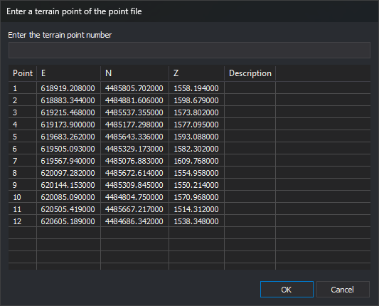

# Enter a terrain point of the point file
<!-- id: introduce-punto-terreno -->
<!-- origen: 0b06f08861b14bf0d2df5cc3c438f4afc8b3c064 -->

This dialog requests the control point to measure. It is opened by the [absolute orientation](../ventana-fotogrametrica/ordenes/o/ori-absoluta.md), [aerial triangulation measurement](../ventana-fotogrametrica/ordenes/a/aerotri.md) and [Orientation](../paneles/orientacion.md) panes used by sensors that support it. It shows points from the [control point file](archivo-de-puntos-de-apoyo.md).

## Fields

* **Enter the terrain point number**: name of the point to measure. Clicking a point in the list copies its name here.
* **Point list**: file points, with their name (**Point**), three coordinates and **Description**. Coordinate column titles are the axis names of the control points' coordinate reference system. If unavailable, the columns are titled **X**, **Y** and **Z**.
* **OK**: measures the specified point. Entering `0` or leaving the field empty selects no point.
* **Cancel**: closes without selecting a point.

## Points that are not accepted

* **Point absent from the point file**:
  * In absolute orientation, Digi3D.AI displays “ERROR: The point *name* does not exist in the points file.” and reopens the dialog.
  * In generic orientation, Digi3D.AI displays “Unable to locate the point: *name* in the loaded control point file.” and reopens the dialog.
  * In aerial triangulation measurement, the point is accepted as an aerial triangulation point.
* **Name matching a projection center** (one of the photo names): Digi3D.AI displays an error and reopens the dialog.
