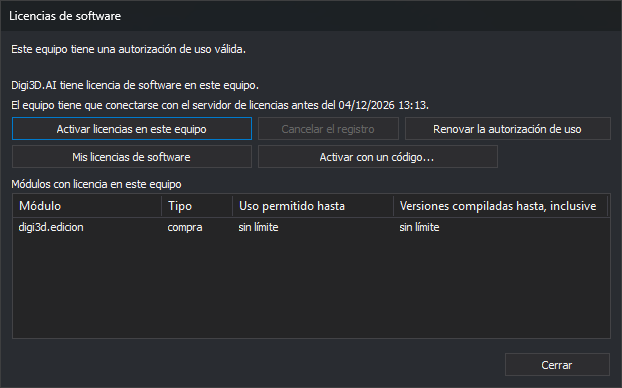
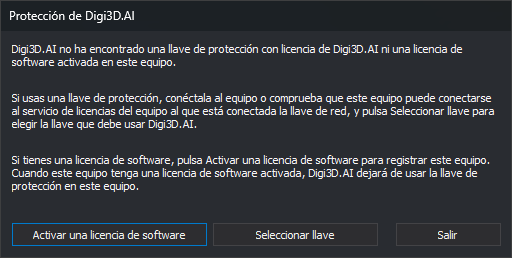
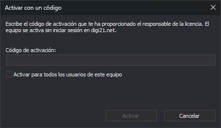

# Software licenses
<!-- id: licencias-de-software -->
<!-- origen: 1c882a9af62a5895fdd689528d502a301de50a15 -->

This dialog box shows the status of the software licenses of the computer and lets you activate the computer, renew the usage authorization, obtain a simultaneous session and check the licensed modules. Digi3D.AI uses software licenses, instead of a dongle, when the computer has a software license activation or when you choose **Activate a software license** in the [Digi3D.AI protection](#choosing-the-protection-when-digi3dai-starts) dialog box. For an overview of software licenses, see the [Software licenses](../../../licencias-de-software/README.md) section.

## Choosing the protection when Digi3D.AI starts

When it starts, Digi3D.AI decides whether to use software licenses or a dongle with the rules described in [How the program chooses between the software license and the dongle](../../../licencias-de-software/README.md#how-the-program-chooses-between-the-software-license-and-the-dongle). When the computer has no software license activation and Digi3D.AI cannot sign in to a dongle that has a Digi3D.AI license, Digi3D.AI shows the **Digi3D.AI protection** dialog box.

The **Digi3D.AI protection** dialog box says that Digi3D.AI has not found a dongle with a Digi3D.AI license or a software license activated on the computer. The **Digi3D.AI protection** dialog box has three buttons:

* **Activate a software license**: Digi3D.AI uses software licenses and opens the **Software licenses** dialog box described on this page, with the **Continue** and **Exit** buttons, so that you can activate the computer. When the computer has a software license activated, Digi3D.AI no longer uses the dongle on that computer.
* **Select dongle**: Digi3D.AI opens the [Select dongle](../../../acerca-llaves-proteccion/programas-relacionados-con-licencias-y-llaves-de-proteccion/selecciona-llave.md) program, waits for it to finish and tries again to sign in to a dongle. If the dongle has a Digi3D.AI license, Digi3D.AI starts with the dongle; otherwise, it shows the **Digi3D.AI protection** dialog box again.
* **Exit**: closes Digi3D.AI without completing the startup.

## Opening the dialog box

The dialog box appears in three cases:

* When Digi3D.AI starts and the computer has no editing license. Digi3D.AI does not continue startup until the computer has an editing license or you click **Exit**.
* When you select **Help/Software licenses...**. When opened from **Help/Software licenses...**, the dialog box has a single button, **Close**.
* When the computer loses the editing license while a drawing is open, for example because the computer's activation has been revoked. While any drawing is open, Digi3D.AI checks the license every 5 minutes. When the dialog box opens because the computer lost the editing license, it has the **Close** and **Exit** buttons.

## Information shown

At the top, the dialog box shows these lines of text, without a label:

* The **status** of the licenses of the computer. The possible texts are:
  * "Digi3D.AI has not read the software licenses of this computer yet."
  * "This computer is not registered. Click Activate this computer to register it."
  * "The registration of this computer is in progress."
  * "This computer has a valid usage authorization."
  * "The usage authorization of this computer has expired or could not be verified. Connect to the Internet and click Renew the usage authorization."
  * "Digi3D.AI needs to synchronize the time with the server. Connect to the Internet and click Renew the usage authorization."
  * "Windows could not open or create this computer's cryptographic key." When Windows cannot open or create this computer's cryptographic key, the activation button is disabled.
* Whether any of the licenses of the computer allows you to run this version of Digi3D.AI (editing license): "Digi3D.AI has a software license on this computer." or "None of the software licenses of this computer allows you to run this version of Digi3D.AI."
* The date and time before which the computer must connect to the licensing server ("This computer must connect to the licensing server before..."). The line appears only when the computer has a valid usage authorization.
* The simultaneous session of the editing license (**Session:** line). The line appears only when the editing license has a simultaneous session or needs one. The possible texts are:
  * "Session: not started." (the editing license needs a session and Digi3D.AI has not requested any yet)
  * "Session: active with *server* (up to *n* programs open at the same time)."
  * "Session: no connection with *server*; the modules authorized by this session remain licensed until *time*."
  * "Session: lost; the modules keep their license until *time*."
  * "Session: no license."

  The **Session:** line displays "no limit" as the time when Digi3D.AI has no time limit for the session. See [Simultaneous sessions](../../../licencias-de-software/sesiones-simultaneas.md).
* The result of the last operation (for example, that the server granted the authorization or that the request failed) or the progress of the operation in progress.

The list of modules appears below the buttons:

* **Licensed modules on this computer**: one row per licensed module, sorted by module name:
  * **Module**: the module name (see [Digi3D.AI modules](#digi3dai-modules)).
  * **Type**: purchase, rental, trial or unknown.
  * **Use permitted until**: the date and time until which you can use the module. The **Use permitted until** column shows "no limit" if the license has no end date.
  * **Versions compiled up to, inclusive**: the most recent build date of the Digi3D.AI versions that can use this module. A version compiled after that date cannot use the module. The **Versions compiled up to, inclusive** column shows "no limit" if the license has no build date limit.

## Activating the computer with approval on digi21.net

1. Click **Activate this computer**. Digi3D.AI requests a user code from the server and opens the verification page in the web browser. The dialog box shows the user code and the address of the page.
2. Check that the browser page shows the same user code as the dialog box. If the browser did not open, type in the browser the address shown in the dialog box ("If the web browser did not open, go to this address:").
3. Sign in to digi21.net.
4. Approve the registration of the computer and choose the licenses to activate on it.
5. Return to Digi3D.AI. While Digi3D.AI waits for approval of the computer registration, the program queries the licensing server, detects the approval automatically and updates the license status and the list of modules. You do not need to click any button.

If the user code expires before you approve the registration, the dialog box says so; click **Activate this computer** to request a new code. If you reject the registration on the page, the dialog box says that it was rejected.

## Activating the computer with an activation code

An activation code activates the computer without any user signing in to digi21.net. Digi21 delivers the activation codes to the license holder. See [Activate with an activation code](../../../licencias-de-software/activar-ordenadores.md#activate-with-an-activation-code).

1. Click **Activate with a code...**. Digi3D.AI opens the **Activate with a code** dialog box.
2. Type the activation code in the **Activation code** field. The **Activate** button is disabled while the field is empty.
3. Select **Activate for all users of this computer** if you want all Windows users of the computer to use the activation. Windows asks for administrator permissions. If you do not select the check box, the activation is available only to the Windows user running Digi3D.AI. If Digi3D.AI already uses an activation for all users of the computer, the check box appears selected and disabled.
4. Click **Activate**. While the activation is in progress, the dialog box shows "Activating the computer..." and disables the field, the check box and the **Activate** button. If the activation is granted, the **Activate with a code** dialog box closes and the **Software licenses** dialog box updates the status and the list of modules. If the activation fails, the **Activate with a code** dialog box shows the reason and enables the field, the check box and the **Activate** button again. The possible reasons are in [Possible results when activating with a code](../../../licencias-de-software/activar-ordenadores.md#possible-results-when-activating-with-a-code).

Click **Cancel** to close the **Activate with a code** dialog box without activating the computer. The `/activar-equipo <code>` command of `Digi3D.exe` activates the computer for all Windows users without showing any dialog box; see [With the /activar-equipo command](../../../licencias-de-software/activar-ordenadores.md#with-the-activar-equipo-command).

## Buttons

* **Activate this computer**: starts the approval procedure on digi21.net when the computer is not registered. If the computer is already registered, the button is named **Activate licenses on this computer** and repeats the same procedure to activate more licenses on the computer. The activation button is disabled while another operation is in progress, while Digi3D.AI starts the licensing service, while the registration of the computer is in progress and when Windows cannot open or create the key of the computer.
* **Cancel the registration**: stops waiting for the approval. The **Cancel the registration** button is enabled only while a computer registration is in progress.
* **Renew the usage authorization**: requests a new usage authorization from the server. The renewal button is enabled when the computer has a valid authorization, when the authorization has expired or when the computer's time must be synchronized. The renewal button is disabled while another operation is in progress.
* **My software licenses**: opens in the web browser the digi21.net page with the software licenses of your account.
* **Activate with a code...**: opens the **Activate with a code** dialog box (see [Activating the computer with an activation code](#activating-the-computer-with-an-activation-code)). The **Activate with a code...** button is enabled under the same conditions as **Activate this computer**.
* **Get a license**: requests a simultaneous session of the editing license immediately and shows in the result line "Digi3D.AI is obtaining a license." followed by "Digi3D.AI has obtained a license." or the reason why Digi3D.AI did not obtain the simultaneous session. The button appears only when the editing license has a simultaneous session or needs one. The **Get a license** button is enabled when no other operation is in progress, the computer has a valid usage authorization and the **Session:** line says "not started", "lost" or "no license".
* **Continue**: closes the dialog box that appears when Digi3D.AI starts and continues the startup. The **Continue** button is enabled only when the computer has an editing license.
* **Exit**: during Digi3D.AI startup, closes the dialog box and Digi3D.AI does not start. When the computer has lost the editing license, closes the dialog box and closes Digi3D.AI as if you closed the main window. The **Exit** button does not appear in the dialog box opened from the **Help** menu.
* **Close**: closes the dialog box opened from the **Help** menu or when the editing license is lost. If the dialog box opened because the editing license was lost and the computer still has no editing license, Digi3D.AI displays the message "You do not have a license for this feature" and opens the dialog box again.

## Usage authorization and offline work

The usage authorization lets you work without an Internet connection until the date shown in the line "This computer must connect to the licensing server before...". When less than a third of the authorization period remains and a connection is available, Digi3D.AI renews the authorization automatically. If that date passes without the computer connecting, the status changes to indicate that the authorization has expired, and you must connect to the Internet and click **Renew the usage authorization**.

When Digi3D.AI renews the usage authorization, the authorization includes the modules added to the computer's license. To update the usage authorization without waiting for the automatic renewal, click **Renew the usage authorization**. If the added module is `digi3d.fotogrametria`, restart Digi3D.AI after renewing the authorization: Digi3D.AI loads the photogrammetric extensions when it starts.

## Digi3D.AI modules

* `digi3d.edicion`: allows you to run Digi3D.AI.
* `digi3d.fotogrametria`: allows you to use the photogrammetric window. Without this module, Digi3D.AI loads only the Digi3D.Orthophoto and Digi3D.CommonCommands extensions, so the photogrammetric window can open only orthophoto models. If the computer's license does not include `digi3d.fotogrametria`, Digi3D.AI displays a missing-license warning when you try to open a model of a sensor other than the orthophoto or run a command from a photogrammetric extension.

## Limitations of this version

* The MDTopX digital terrain model commands (triangulation and DTM importer) are not available.
* You cannot open or create encrypted code tables.
