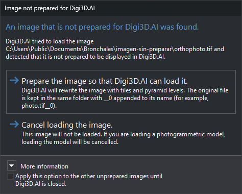

# Image not prepared for Digi3D.AI
<!-- id: localizada-una-imagen-no-preparada-para-digi3d-ai -->
<!-- origen: 881f2bf8863a23cd1c67582c91c41ff20700c21b -->

Digi3D.AI displays this dialog when loading sensor images (orthophoto, conical camera, satellite sensors, ADS40…) if a TIFF image is not tiled. Digi3D.AI requires tiled TIFF images to avoid loading the entire image into memory.

A tiled image without pyramid levels does not open this dialog.

## Contents

* Path of the unprepared image.
* **More information**: explains tiles and pyramid levels.

## Buttons

The dialog has no close button. Esc is equivalent to **Cancel loading the image.**.

* **Prepare the image so that Digi3D.AI can load it.**: renames the original by appending `__0` to its full filename (for example, `foto.tif` becomes `foto.tif__0`; if that file exists, uses `__1`, `__2`…). Then writes a tiled TIFF with pyramid levels inside the same file at the original path and loads it. The results window and status bar show progress. If conversion fails, the image is not loaded and the original retains its `__0` suffix.
* **Cancel loading the image.**: does not load the image. If it belongs to a photogrammetric model, the model is not loaded.

## Apply this option to the other unprepared images until Digi3D.AI is closed checkbox

Select “Apply this option to the other unprepared images until Digi3D.AI is closed.” to save the action of the button you click (or cancellation with Esc) and apply it without showing the dialog to all unprepared images loaded until Digi3D.AI closes.

## Notes

To prepare several images together without opening them in Digi3D.AI, use the [Pyramid level generator](../generador-de-niveles-piramidales.md).
