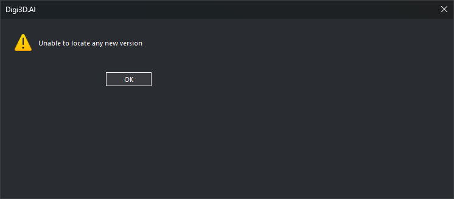
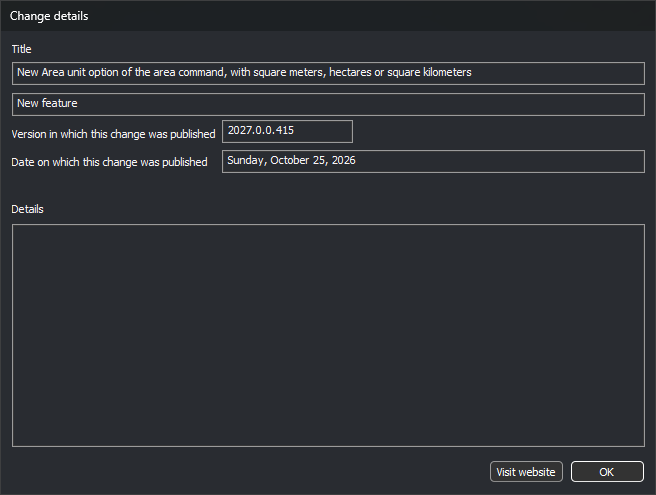
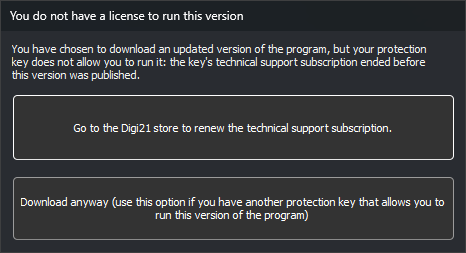

# Located a new version
<!-- id: localizada-una-version-nueva -->
<!-- origen: 9a860f5830a1020f6d2c64dd21037048bfbb9f9e -->

Digi3D.AI displays this dialog when a newer program version than the installed one has been published. The list contains features and fixes from versions published after the installed version's compilation date.

## When it appears

* At startup, if [Check for a new version](configuracion/comunicacion-con-internet/comprobar-version-nueva.md) is **Yes**.
* When selecting **Tools/Check for a new version...**. If none exists, Digi3D.AI displays “Unable to locate any new version”.

Digi3D.AI checks versions published on www.digi21.net. If [Allow installing BETA versions](configuracion/comunicacion-con-internet/permitir-instalar-versiones-beta.md) is **Yes**, the list includes BETA versions. Release notes appear in the interface language.

## Release notes list

Each row is a feature or fix from a version:

* **Release/Correction**: row type.
* **Title**: short description.
* **Version**: version in which it was published.
* **Date**: that version's publication date.

Double-click a row to open [Details of the new release](#details-of-the-new-release).

## Buttons

* **Install**: downloads and runs the installer for the latest listed version.
  * If the dongle's technical support subscription ended before that version's publication date, Digi3D.AI first displays [You do not have a license to run this version](#you-do-not-have-a-license-to-run-this-version).
  * **Downloading** shows a progress bar during download. Its **Cancel** button stops the download.
  * If the dialog appeared at startup, Digi3D.AI closes so the installer can replace it. If opened from **Tools**, Digi3D.AI stays open while the installer runs.
* **Omit**: closes without downloading anything.

## Details of the new release

Shows the item in the double-clicked row:

* **Title**: short description.
* Type: **Release** or **Correction**.
* **Version in which this release was published**.
* **Date on which this release was published**.
* **Details**: full description, if provided.
* **Visit website**: opens the help page explaining the item. Disabled if the item has no page.
* **Accept**: closes the dialog.

## You do not have a license to run this version

Digi3D.AI displays this dialog when you click **Install** if the dongle's technical support subscription ended before the new version's publication date. That dongle cannot run the new version.

* **Go to the Digi21 store to renew the subscription for technical support.**: opens the www.digi21.net store and closes both dialogs without downloading anything.
* **Download anyway**: downloads and runs the installer. Use if you have another dongle that can run this version.

There is no close button. Esc is equivalent to **Download anyway**.
