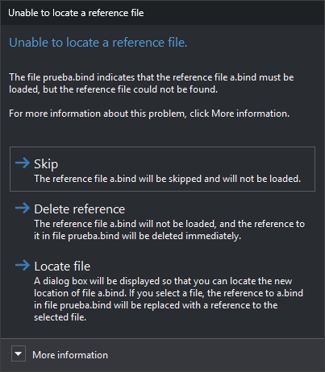

# Unable to locate a reference file
<!-- id: no-se-ha-localizado-un-archivo-de-referencia -->
<!-- origen: 2176de90ccbcbc4c052ba0a3f6f2e6cbe8d17857 -->

Digi3D.AI displays this dialog when opening a drawing file if a reference file no longer exists at its saved path. One dialog appears for each missing reference file. If you selected files in [Reference file selection](seleccion-de-archivos-de-referencia.md), only those selected are checked.

The contents identify the drawing file containing the reference and the missing reference filename.

## Contents

* **More information**: full path of the reference file that could not be located, as saved in the [reference file list file](../archivos/archivo-de-archivos-de-referencia.md) or drawing file.

## Buttons

Neither Esc nor the window close button can close the dialog: you must choose one of these buttons.

* **Omit**: does not load this reference file or modify the drawing file. The reference remains saved and the dialog reappears next time you open the drawing file.
* **Delete reference**: does not load the reference file and removes the reference immediately, without waiting for a save: it is removed from the drawing file and reference file list file. Equivalent to [LEAVE](../ventana-de-dibujo/ordenes/d/dejar.md). Does not mark the document as modified. If the drawing file is read-only, its reference is not removed and the dialog reappears next time.
* **Locate file**: opens a file selection dialog titled “Locates the new file location”, followed by the missing filename. It proposes that filename and opens in the drawing file's folder if saved on disk. Accepting replaces the old reference in the drawing file with the selected file's full path and loads it. Cancelling has the same effect as **Omit**.
