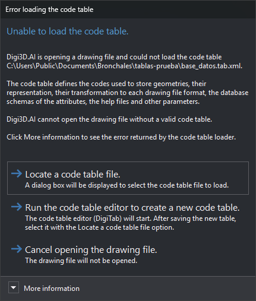

# Unable to load the code table
<!-- id: no-se-ha-podido-cargar-la-tabla-de-codigos -->
<!-- origen: 8c473ab5e2873c1a39d4f882244db41b77e92563 -->

Digi3D.AI displays this dialog when opening a drawing file if its specified [code table](nuevo-proyecto/archivo-de-dibujo.md) cannot be loaded. The contents show the code table path with [placeholders](sustituidores.md) already resolved.

Possible causes include:

* The code table file does not exist.
* The file is not valid XML. The error identifies the line and column.
* The code table has no color palette, styles or codes.
* The code table is encrypted and the dongle has no license to use it, or the license has expired.

## Contents

* **More information**: error text returned by the code table loader.

## Buttons

Neither Esc nor the window close button can close the dialog: you must choose one of these buttons.

* **Locate a code table file.**: opens a dialog to select a `.tab.xml` or `.dt` file. Digi3D.AI tries loading the selected table. Cancelling selection retries the same code table; if loading fails, this dialog reappears.
* **Run the code table editor to create a new code table.**: runs the [code table editor](../editor-de-tablas-de-codigos/README.md) (DigiTab) and retries loading the same code table, so this dialog reappears. After saving the new table in the editor, click **Locate a code table file.** and select it.
* **Cancel opening the drawing file.**: the drawing file is not opened.
