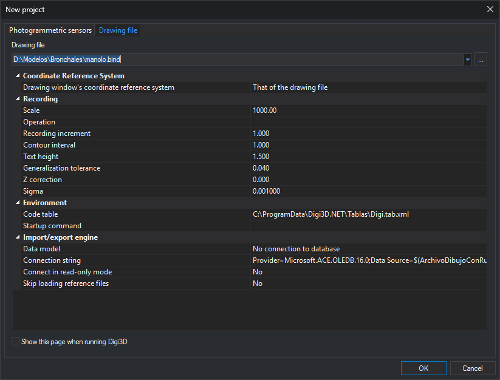

# New project
<!-- id: nuevo-proyecto-2 -->
<!-- origen: f0a2fc174a3f10f4ad312166fbfb2a4f3eeb3dca -->

This dialog opens a photogrammetric model in a photogrammetric window or a drawing file in a drawing window, depending on the active tab when you click **OK**:

* [Photogrammetric sensors](sensores-fotogrametricos.md): opens or creates a photogrammetric model.
* [Drawing file](archivo-de-dibujo.md): opens a drawing file.

Digi3D.AI displays this dialog when started without arguments and when selecting **File/New/Open photogrammetric model or drawing file...** from the menu.
