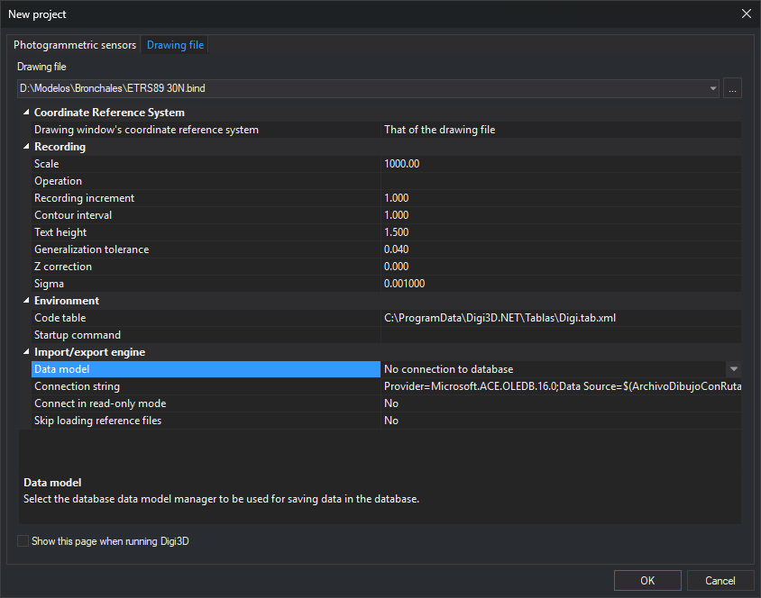

# Drawing file
<!-- id: archivo-de-dibujo -->
<!-- origen: c21d100d03836eb56c356169614dbf1d898117ed -->

This tab of [New project](README.md) opens a drawing file in a drawing window and sets its working parameters.

## Opening the tab

Select **File/New/Open photogrammetric model or drawing file...** from the menu and click **Drawing file**.

## Fields

* **Drawing file**: path of the file to open. The drop-down list offers the last ten files opened from this tab, and **...** lets you browse for one.
* **Show this page when running Digi3D**: New project opens on this tab instead of [Photogrammetric sensors](sensores-fotogrametricos.md).

A property grid grouped by category appears below **Drawing file**.

### Coordinate Reference System

This category only appears if the option to display the reference system when opening a drawing file is enabled.

* **Drawing window's coordinate reference system**: system in which the window works. **That of the drawing file** uses the file system. If the category does not appear, the window works in a local compound reference system.

### Recording

* **Scale**: display scale of line patterns. The drop-down list offers common scales, from 1:100 to 1:250,000, and you can enter any other scale.
* **Operation**: **Save** stores registration increment, contour interval, and generalization tolerance, together with text height, for the specified scale. **Load** retrieves the values stored for that scale.
* **Recording increment**: interval in meters at which points are registered when digitizing in continuous mode.
* **Equidistance**: interval in meters at which contour lines are registered.
* **Text height**: height of registered texts, the value of [TH](../../ventana-de-dibujo/variables/a/at.md).
* **Tolerance to be generalized**: minimum segment length when digitizing in continuous mode.
* **Z correction**: Z difference between operators. Adjust it if the person who performed absolute orientation differs from the person plotting the model.
* **Sigma**: value below which two values are considered identical.

### Environment

* **Code table**: file containing codes, their representation, and translation, in `.dt` or `.tab.xml` format. The drop-down list offers recently used tables.
* **Startup command**: command run whenever a drawing file opens, including from the command line. It runs after code table startup commands and before the command specified on the command line. To run a macroinstruction file, enter `@` followed by its path.

### Import/export engine

This category displays importer or exporter parameters for the drawing file format. Parameters vary according to the selected file extension: for example, for the `.bind` file in the screenshot, the category displays the data model, database connection string, read-only connection, and skipping of reference files.

The following table lists formats you can open in a drawing window and links to pages explaining their parameters, in the **Import/export engine parameters** section of each page:

| Format | Extension | Parameters |
| :--- | :--- | :--- |
| Digi files | `.bin`, `.bik` | [Digi files](../../ventana-de-dibujo/importadores-y-exportadores/bin.md) |
| Double precision Digi files | `.bind` | [Double precision Digi files](../../ventana-de-dibujo/importadores-y-exportadores/bin-doble-precision.md) |
| MicroStation DGN v8 | `.dgn` | [DGN](../../ventana-de-dibujo/importadores-y-exportadores/dgn.md) |
| AutoCAD DWG | `.dwg` | [DWG](../../ventana-de-dibujo/importadores-y-exportadores/dwg.md) |
| ESRI Shapefile | `.shp` | [Shapefile](../../ventana-de-dibujo/importadores-y-exportadores/shp.md) |
| Geomedia Datawarehouse | `.mdb` | [Geomedia](../../ventana-de-dibujo/importadores-y-exportadores/geomedia.md) |
| Google Earth KML | `.kml` | [KML](../../ventana-de-dibujo/importadores-y-exportadores/kml.md) |
| PostGIS connection | `.pg` | [PostGIS](../../ventana-de-dibujo/importadores-y-exportadores/postgis.md) |
| Esri FileGDB | `.gdb` | [FileGDB](../../ventana-de-dibujo/importadores-y-exportadores/filegdb.md). The category appears empty; accepting displays the dataset selection dialog. |
| GeoPackage | `.gpkg` | [GeoPackage](../../ventana-de-dibujo/importadores-y-exportadores/geopackage.md). The category appears empty. |
| WKT | `.wkt` | [WKT](../../ventana-de-dibujo/importadores-y-exportadores/wkt.md). The category appears empty. |
| ArcGIS DEM | `.asc` | [ArcGIS DEM](../../ventana-de-dibujo/importadores-y-exportadores/arcgis-dem.md). Has no parameters. |
| Raster images | Supported image format extensions | [Raster images](../../ventana-de-dibujo/importadores-y-exportadores/raster.md) |
| WMS | `.wmsconnection` | [WMS](../../ventana-de-dibujo/importadores-y-exportadores/wms.md) |

If the format requires a coordinate reference system and the file has none (for example, when creating a new file), clicking **OK** makes Digi3D.AI display **Select the reference coordinate system to be assigned to the file**. Each format page explains where the selected system is saved.

## Notes

Clicking **OK** makes Digi3D.AI save the grid values. The next time you open the Drawing file tab, saved values become the initial values. The first time you open it, values are: scale 1:1000, registration increment 1 meter, contour interval 1 meter, text height 1.5 drawing length units, generalization tolerance 0.04 drawing file coordinate units, Z correction 0, and sigma 0.001.

If drawing file projects are enabled, the grid displays **Drawing file configuration**, containing the configuration applied to the file. Configurations are created in [Configure projects](../configurar-proyectos.md). If the selected configuration does not configure import/export engine parameters, the grid also displays **Import/export engine**. Clicking **OK** replaces registration values, code table, startup command, and coordinate reference system with those of the selected configuration. If no configuration is selected, Digi3D.AI displays “You have not selected any drawing file configuration.” It does not open the file, and leaves the dialog open.

## File opening errors

* If a drawing window is already open, Digi3D.AI displays “Two drawing files cannot be opened simultaneously.” and does not open the file.
* If the file path is invalid, Digi3D.AI displays **Error when creating drawing file** with the text “Unable to create drawing file.”
