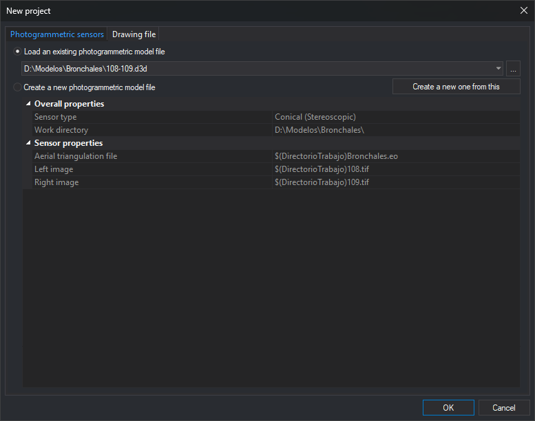

# Photogrammetric sensors
<!-- id: sensores-fotogrametricos -->
<!-- origen: 412d388c6448a23442cd7569a0247303f2cef0b4 -->

This [New project](README.md) tab opens a photogrammetric model in a photogrammetric window. The model is saved in a model file (`.d3d`) specifying its sensor and files (images, orientations, camera…).

## Fields

* **Load an existing photogrammetric model file**: opens a previously created `.d3d`.
  * **File list**: last ten model files opened or created with **OK** on this tab. Files that no longer exist are omitted.
  * **...**: selects another `.d3d`, adds it if not listed and selects it. File selection opens in Digi3D.AI's last used folder. This button, **Work directory** and other file selection dialogs update that folder.
  * **Property grid**: shows the selected file's properties in gray, without editing, so you can check what will be loaded. **Overall properties** contains **Sensor type** and **Work directory**, the file's folder. **Sensor properties** contains sensor parameters; paths saved relative to the work directory appear with the prefix `$(DirectorioTrabajo)`, for example `$(DirectorioTrabajo)108.tif`. If the file cannot be read, **Sensor type** shows the reason. With [Web Map Service](../../ventana-fotogrametrica/sensores/wms.md) and [Web Map Tile Service](../../ventana-fotogrametrica/sensores/wmts.md), the grid shows saved values without connecting to the server.
  * **Create a new one from this**: prepares a new model with the selected file's data. Only available when the grid shows properties of a readable file. Selects **Create a new photogrammetric model file** and fills **Work directory**, **Sensor type** and sensor properties with editable values from the file. Paths prefixed with `$(DirectorioTrabajo)` become absolute so the new model can be saved elsewhere. For example, creating Conical model `109-110` from `108-109` only requires changing the images: the aerial triangulation file and work directory are retained. All data saved by the sensor in the model file are copied, including data absent from the grid, such as Conical camera files. The last cursor position, scale factor and image rotations are not copied.
* **Create a new photogrammetric model file**: creates and opens a `.d3d`.
  * **Overall properties**
    * **Work directory**: folder where the model file is created. Initially the last created model's folder.
    * **Sensor type**: model sensor. The alphabetical list offers installed sensors allowed by the license. Without the photogrammetry module, only the orthophoto sensor is offered.
  * **Sensor properties**: selected sensor parameters. Each sensor requires its own; for example, Conical requires the aerial triangulation file and left and right images.
* **OK**: opens the selected file, or creates a file with the sensor's model name and opens it. If that name already exists in the work directory, Digi3D.AI writes sensor data without confirmation, except when **Create a new one from this** was used and the destination is the copied model's file. In that case (for example, if no data changed), Digi3D.AI asks whether to overwrite the copied model file. **Yes** writes sensor data there and removes image rotations for Conical, or the last cursor position and scale factor for Web Map Service. **No** leaves the dialog open. If no **Sensor type** is selected under **Create a new photogrammetric model file**, no file is created and the selected **Load an existing photogrammetric model file** entry is opened. For [Web Map Service](../../ventana-fotogrametrica/sensores/wms.md) and [Web Map Tile Service](../../ventana-fotogrametrica/sensores/wmts.md), the only sensor property is **Server URL**: if empty or invalid, a message appears, the property is selected and the dialog remains open. The layer and other parameters are selected after opening the model, in the photogrammetric window's sensor pane.
* **Cancel**: closes without opening anything.

With **Configuration**'s [Store the photogrammetric project or model as a reference file](../configuracion/archivos-de-referencia/almacenar-el-proyecto-o-el-modelo-fotogrametrico.md) enabled, if the [Photogrammetric project](../../paneles/proyecto-fotogrametrico.md) pane has no loaded project, Digi3D.AI saves the opened model path in the drawing file's [reference file list file](../../archivos/archivo-de-archivos-de-referencia.md#photogrammetric-project-or-model), provided a drawing window is open and its drawing file is writable. When opening a drawing file with an associated photogrammetric model, Digi3D.AI opens the model in a photogrammetric window in the cases described under Photogrammetric project or model in the reference file list file documentation.
