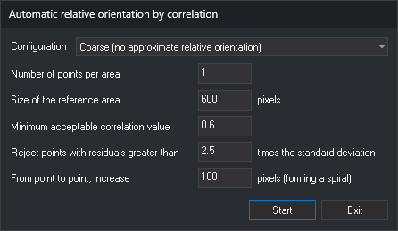

# Automatic relative orientation by correlation
<!-- id: orientacion-relativa-automatica-por-correlacion -->
<!-- origen: 7e099c4d6f4a4246ae955c65843efb50e3a85829 -->

This dialog measures relative orientation points by correlation. It opens in two cases:

* Clicking **Correlate all** in the **Relative orientation** pane of [RELATIVE\_ORI](/digi3d-ai/referencia/ventana-fotogrametrica/ordenes/o/ori_relativa.md). **Schema** is absent: correlation areas are the pane's point positions, from the schema or already measured.
* Loading a photogrammetric project with models lacking relative orientation and accepting to calculate it. **Schema** appears; **Start** closes without saving values, and Digi3D.AI uses them to calculate relative orientation for all those models.

## Fields

* **Schema**: Von Gruber pattern whose points define correlation areas.
* **Configuration**: set of values for the following fields. Digi3D.AI saves each configuration's values separately and loads them when selected.
  * **Coarse (no approximate relative orientation)**: defaults to 9 points per area, reference area of 600 pixels, minimum correlation 0.6, factor 2.5 and increment of 100 pixels.
  * **Fine (correlation zones marked)**: defaults to 6 points per area, reference area of 400 pixels, minimum correlation 0.7, factor 2.5 and increment of 100 pixels.
* **Number of points per area**: maximum number sought in each area.
* **Size of the reference area**: side length, in full-resolution image pixels, of the left-image window sought in the right image at pyramid level 16.
* **Minimum acceptable correlation value**: points below this correlation factor are discarded.
* **Reject points with residuals greater than ... times the standard deviation**: after each relative orientation calculation, excludes the point with the largest residual exceeding this multiple of standard deviation. Repeats until no point exceeds it.
* **From point to point, increase ... pixels (forming a spiral)**: pixel distance between tested points around each area's center. Points are traversed in a spiral from the center.

## Process

Clicking **Start** from **Relative orientation** saves the selected configuration's values and, for each area:

1. Finds the area in the right image at pyramid levels 16 and 8.
2. Traverses surrounding points in a spiral and correlates each at levels 4 and 1. Accepts points whose correlation factor exceeds the minimum, until reaching the number of points per area.

The status bar shows **Correlating area N...** and correlation progress. After correlating areas, Digi3D.AI calculates relative orientation with robust estimators and excludes points whose residuals exceed the configured multiple of standard deviation. If any area has no points left, it displays a message listing those areas. If no area has points, it displays **No measured points available with which to carry out the calculation of relative orientation.** and leaves the dialog open for changing values.

If calculation completes, the dialog closes and **Relative orientation** shows points used in the calculation. If every area has points, the list starts with each area's point having the smallest error calculated from residuals, in area order.

**Exit** closes without correlating.
