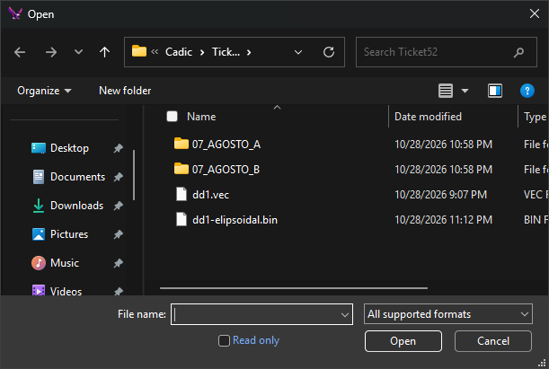

# Import/export parameters
<!-- id: parametros-de-importacion-exportacion -->
<!-- origen: e22ca7f17f781e6011df201f78a9529836374393 -->

Digi3D.AI displays this dialog to request a file's importer/exporter parameters, for example for a DWG file. Each format's parameters are described on its page under [Importers and exporters](/digi3d-ai/referencia/ventana-de-dibujo/importadores-y-exportadores/README.md).

There are two versions, with the same title:

* **After choosing the file** in a command's Open or Save dialog, such as [IMPORT](/digi3d-ai/referencia/ventana-de-dibujo/ordenes/i/importar.md), [EXPORT](/digi3d-ai/referencia/ventana-de-dibujo/ordenes/e/exportar.md) or [LOAD\_F](/digi3d-ai/referencia/ventana-de-dibujo/ordenes/c/carga-f.md) without parameters. This is the version pictured: it has only the property grid and buttons.
* **When loading a file by name**, for example with LOAD\_F and a filename parameter, or when opening a drawing file whose saved reference files have no saved parameters. Above the grid it shows the file path, a notice and a link.

## When it appears

**After choosing the file**, the dialog appears whenever the format has parameters, the command adds its own properties or the command supports a database. It shows the format's default parameters, if any, or the last parameters used for that format. It is only omitted if the drawing file project selected in **New project** has **Configure import/export parameters** selected (see [Configure projects](configurar-proyectos.md)).

**When loading a file by name**, the dialog does not appear if:

* The format has no parameters to request.
* The format has default parameters set with **Default** or [IMPORTATION\_PARAMETERS](/digi3d-ai/referencia/ventana-de-dibujo/ordenes/p/parametros-importacion.md).

## Fields

* **Digi3D.AI will create/load the following file**: only in the version shown when loading by name. The path of the file to create or load; it cannot be edited. In some operations, such as LOAD\_F with a filename parameter, it shows only the extension.
* **Click here to learn how to prevent Digi3D.AI from showing this dialog box**: only in the version shown when loading by name. Opens [IMPORTATION\_PARAMETERS](/digi3d-ai/referencia/ventana-de-dibujo/ordenes/p/parametros-importacion.md), which sets a format's parameters without displaying this dialog.
* Command properties: some commands add their own category before **Digi3D.AI Properties**; those supporting a database add a category with the data model and connection string. Only in the version shown after choosing a file.
* **Digi3D.AI Properties**
  * **Default**: with **Yes**, clicking **OK** saves these parameters as the format's defaults until Digi3D.AI closes. `IMPORTATION_PARAMETERS` replaces them with its own parameters. Some formats do not support this option. At startup it is **Yes** in the version shown after choosing a file and **No** in the version shown when loading by name; each version then remembers its last selected value until Digi3D.AI closes.
* **Importer/exporter properties**: the file format's parameters.
* **OK**: opens, imports or exports the file with these parameters. After choosing a file, the parameters are also saved as the last used for that format.
* **Cancel**: cancels the operation. Exception: with LOAD\_F and a filename parameter, the dialog appears again with the full file path; **Cancel** in this second dialog cancels loading.

The dialog can be resized and retains its size and position.
