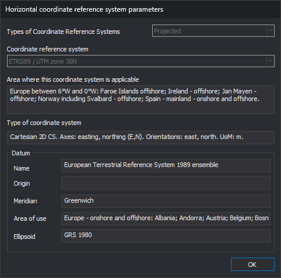
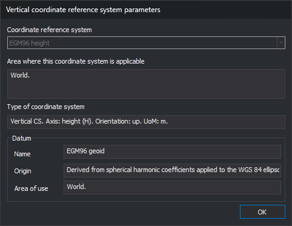
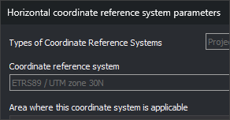

# Coordinate reference system parameters
<!-- id: parametros-del-sistema-de-referencia-de-coordenadas -->
<!-- origen: 99507fa57f766bc9f98e6c11c8036453838cd7ad -->

These dialogs show horizontal or vertical coordinate reference system parameters for the drawing window or a drawing file. They are read-only: they do not change the reference system.

## Opening the dialogs

* On the [Coordinates](../barras-de-herramientas/coordenadas.md) toolbar, open the units button's arrow menu and select **Show horizontal reference coordinate system...** or **Show vertical reference coordinate system...**.
* In the [Drawing files](../paneles/archivos-de-dibujo.md) pane, select the same options in a file's context menu.

## Horizontal system

* **Types of Coordinate Reference Systems**: system type: _Local_, _Projected_ or _Geographic 2D_.
* **Coordinate reference system**: system name.
* **Area where this coordinate systems is applicable**: geographic area where EPSG defines the system.
* **Type of coordinate system**: system axes, their orientation and unit of measure.
* **Datum**: system geodetic datum. For a projected system, the datum of its base geographic system.
  * **Name**: datum name.
  * **Origin**: description of the datum origin. Empty when EPSG does not define one, as for the ETRS89 datum, which is an ensemble of realizations.
  * **Meridian**: longitude origin meridian.
  * **Area of use**: area where EPSG defines the datum.
  * **Ellipsoid**: datum ellipsoid.

## Vertical system

* **Coordinate reference system**: vertical system name.
* **Area where this coordinate system is applicable** and **Type of coordinate system**: as for the horizontal system.
* **Datum**: vertical datum, with its **Name**, **Origin** and **Area of use**.

## Non-EPSG systems

If the reference system has no EPSG code because it was read from WKT without a code, the dialogs show information contained in the WKT itself: for the horizontal system, datum, meridian and ellipsoid names; for the vertical system, the datum name. Area, coordinate system type, origin and area of use remain empty because that information is only in the EPSG catalog.

## Unknown system

If the reference system is unknown, these dialogs are replaced with this message:

