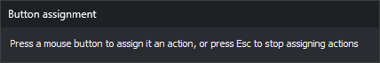
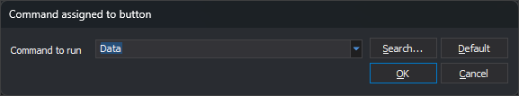

# Programming buttons
<!-- id: programar-botones -->
<!-- origen: 374be2c52ec1ee69b0c0f44f2abed0e9dbfe45ba -->

This dialog assigns a command or action to each button of mice, joysticks, and controllers connected to the computer. Its title is **Button assignment**.

## Opening the dialog

Select **Tools/Assign command to buttons...** from the menu. This option only appears in the menu Digi3D.AI displays when no drawing or photogrammetric window is open.

## Using the dialog

1. Press the mouse, joystick, or controller button you want to program. **Command assigned to button** opens.
2. Choose the action or command the button runs and click **OK**.
3. Repeat for each button you want to program.
4. Press **Esc** to finish.

Assignments are saved for the _Windows_ user and device name. Two devices with the same name share assignments.

While the dialog waits for you to press a button, the mouse pointer is hidden. The dialog has no close button: close it with **Esc**.

### Mouse button numbers

Each mouse button has a number:

| Button | Number |
| :--- | :--- |
| Left | 1 |
| Middle | 2 |
| Right | 4 |
| Fourth button | 8 |
| Fifth button | 16 |

Actions are also numbers: **Data** is 1, **Snap** is 2, and **Cancel** is 4. Thus, without any assignment, the left button enters data, the middle button snaps, and the right button cancels.

## Command assigned to button

This dialog is opened by **Assign command to buttons** and **Buttons...** in [Configuration of input devices](configuracion-de-dispositivos-de-entrada.md).

* **Command to be run**: the command run by the button, or one of these actions: **Data**, **Snap**, **Cancel**, **Combine**, and **Clutch**. You can enter any command name. If you enter a number other than 0, the button acts as the button with that number. For example, `4` makes it act as the right mouse button.
* **Search...**: opens [Search command](buscar-orden.md), where you can choose a command by name or description. The selected command is entered in **Command to be run**. The assignment is not saved until you click **OK**.
* **Default**: restores the default button action.
* **OK**: saves the assignment.
* **Cancel**: closes the dialog without changing the assignment.
