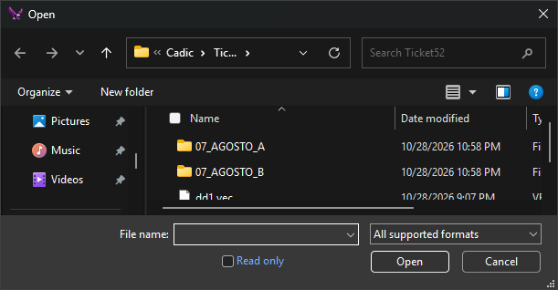

# Tables selection
<!-- id: seleccion-de-tablas -->
<!-- origen: 2b5e920ab3c28c23074a0bf524b03e3e71cd38f8 -->

Digi3D.AI displays this dialog when opening a file or database containing layers or geometry tables, even just one, if that format's option to ask which layers to load is enabled. For example, GeoPackage's [Ask for layers to load](configuracion/geopackage/preguntar-por-capas-al-cargar.md) option.

## Fields

* **Layer list**: the file's layers, with each layer's name and entity count. Select the layers to open. Initially all layers are selected. Names appear as *schema.layer*; for formats without schemas, the schema is empty and the name starts with a period.
* **All** and **None**: select or clear all layers.
* **Save**: saves the list of selected layers. A single list is saved for all formats: saving for one format replaces the list saved for another. With **Schemas** selected, schema names are saved.
* **Load**: selects layers saved with **Save** that exist in the list and clears the others. This repeats the selection in another file with the same layers. With **Schemas** selected, it compares the saved list with schema names.
* **Schemas**: shows one item per schema, with the total entity count of its layers, rather than a row per layer. Selecting a schema opens all its layers. Changing this option repopulates the list with all items selected.
* **OK**: opens the selected layers.

There is no **Cancel** button. Press **Esc** to close without accepting. The effect depends on the format:

* SHP and GeoPackage: no layers are loaded.
* PostGIS: no tables are loaded.
* GeoMedia: Digi3D.AI displays “The file cannot be loaded if at least one layer is not selected.”
