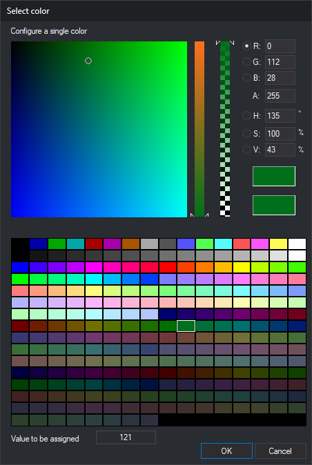
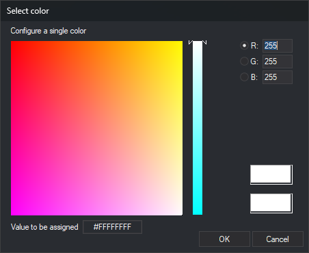

# Select color
<!-- id: seleccionar-color -->
<!-- origen: 234feaad46f56d0b9bb9effba635e751e75df6d2 -->

This dialog selects a color. It has two versions:

* **With palette**: opened by **...** in code representation color properties in the code table editor's [Codes](../editor-de-tablas-de-codigos/pestanas/codigos/README.md) tab: **Color** (drawing window), **Stereo color** (photogrammetric window), **Background color** and **Site background color**. Also opened by [BACKGROUND_COLOR](../ventana-de-dibujo/variables/c/color-fondo.md) and [UNKNOWN_COLOR](../ventana-de-dibujo/ordenes/c/color-desconocido.md) if a code table is loaded. Selects a code table palette color or an RGB color with transparency.
* **Without palette**: opened by other color properties, such as those in [Configuration](configuracion/README.md) or a database field's background color, and by [POINTER_COLOUR](../ventana-fotogrametrica/ordenes/c/color-indice.md). Selects an RGB color.

## Fields

* **Configure a single color**: the large square and the vertical bar to its right select the color. The selected radio button determines which component the vertical bar controls; the square varies the other two.
* **R**, **G** and **B**: red, green and blue components, from 0 to 255.
* **A**: opacity, from 0 (transparent) to 255 (opaque). The second vertical bar also changes it. Absent when the edited value does not store opacity, such as a field's background color or command colors.
* **H**, **S** and **V** (with palette only): hue in degrees (0 to 359), saturation and brightness as percentages.
* **Color samples**: the upper sample shows the selected color; the lower one shows the initial color. Clicking the lower one restores the initial color.
* **Palette** (with palette only): the code table's 256 palette colors. Click one to select it. [BACKGROUND_COLOR](../ventana-de-dibujo/variables/c/color-fondo.md) and [UNKNOWN_COLOR](../ventana-de-dibujo/ordenes/c/color-desconocido.md) save that entry's RGB color, rather than its number.
* **Value to be assigned**: the value assigned to the property. The color number if a palette color is selected, or `#RRGGBBAA` (red, green, blue and opacity in hexadecimal) otherwise.
* **OK**: assigns the color. If the values entered in **R**, **G**, **B** or **A** differ from the selected color, assigns the entered values as `#RRGGBBAA`.
* **Cancel**: closes the dialog without changing the color.
