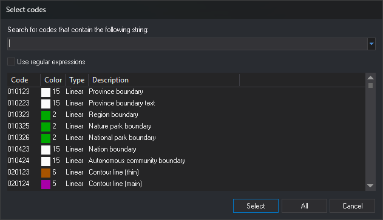

# Select codes
<!-- id: seleccione-codigos -->
<!-- origen: 80ee5dac65cf4ebd156b7cbdc3c5db3301a682a7 -->

This dialog box searches the code table so you can select one or more codes. It opens from **Add...** in [Select codes](selecciona-codigos.md) and directly from some commands, such as [COD](../ventana-de-dibujo/ordenes/c/cod.md).

The title bar shows "Select codes", the same title as [Select codes](selecciona-codigos.md), but these are different dialog boxes: this one searches the code table; the other holds the code list passed to a command and has **Clear**, **Delete**, and **Add...** buttons. The command opening the dialog box can replace its title with its own text.

## Fields

* **Search for codes that contain the following string**: search text. The list displays codes whose name or description contains that text, case-insensitively, and codes whose name matches the text followed by `*`. The drop-down list offers code table tags prefixed with `#`: choosing one displays codes with that tag.
* **Use regular expressions**: interpret the text as a regular expression that must match the full code name or full description, case-insensitively. Invalid expressions leave the list empty. If comparing the expression with a code is too expensive (for example, `(a*)*b` with long text), the search stops at that code. Digi3D.AI remembers this check box state.
* **Code list**: search results in the **Code**, **Color** (color sample and number), **Type** (**Linear**, **Point**, or **Virtual**), and **Description** columns. Codes with [Activated](../editor-de-tablas-de-codigos/pestanas/codigos/propiedades-del-codigo.md#activated) set to **No** appear only if the command opening the dialog box allows them. If the search text starts with `#`, including when typed manually, the list displays codes with that tag and regular expressions are not applied.
* **Select**: pass the codes selected in the list. If none are selected, pass the entered text as a code; it can contain wildcards. Double-clicking a listed code is equivalent to selecting it and clicking this button.
* **All**: pass all listed codes.
* **Cancel**: close the dialog box without passing any code.

## Using the dialog box

1. Type part of a code name or description in the search field, or choose a tag in the drop-down list.
2. Select the codes you need. Hold **Ctrl** or **Shift** while clicking to select multiple codes.
3. Click **Select**, or **All** to pass all listed codes.

## Notes

If the command opening the dialog box accepts only one code, the list allows a single selection and **All** is disabled.
