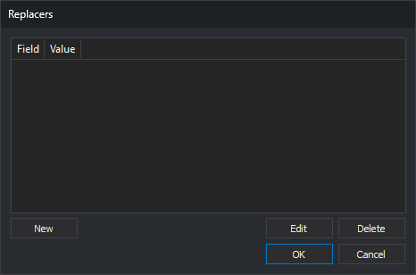
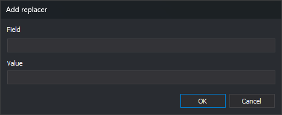

# Replacers
<!-- id: sustituidores -->
<!-- origen: 4ca7d652e1f16698dc8761bc839461f045567707 -->

This dialog edits a list of value pairs. It is opened by **...** in two properties; the column titles depend on the property that opens it:

| Property | Location | Columns | What each pair does |
| :--- | :--- | :--- | :--- |
| Read only the geometries that have the following values | [PostGIS](../ventana-de-dibujo/importadores-y-exportadores/postgis.md) import/export engine parameters | **Field** and **Value** | Only geometries whose field has that value are read. When saving entities, the field takes that value. |
| Paths to replace | [ADS](../ventana-fotogrametrica/sensores/ads.md) sensor properties | **Path to replace** and **Replace with** | In paths read by the sensor, the first path is replaced with the second. |

## Fields

* **List**: one pair per row.
* **New**: opens **Add replacer**. If the list already contains a row with the same value in the first column (ignoring case), the pair is not added and no warning appears.
* **Edit**: opens **Add replacer** with the selected row's values. Editing does not check for duplicate first-column values.
* **Delete**: deletes the selected row.
* **OK**: saves the list in the property.
* **Cancel**: closes the dialog without changing the property.

## Add replacer dialog

It has two text boxes, one per column, with the column title above each. **OK** adds or changes the row; **Cancel** leaves it unchanged.

## Notes

The property stores pairs as a text string with semicolon-separated values: `campo1;valor1;campo2;valor2;`.

In the ADS sensor's **Paths to replace** property, if the text contains no semicolon, the sensor replaces that path with the project's working folder.
