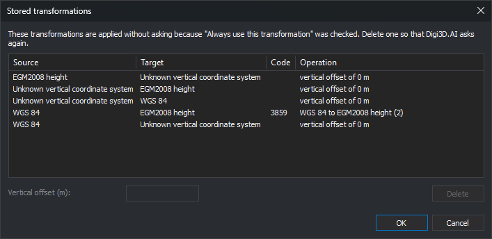

# Stored transformations
<!-- id: transformaciones-memorizadas -->
<!-- origen: fd51f3c479b81105988502a05d0e70adb4964d58 -->

When Digi3D.AI does not know how to transform coordinates between two reference systems, it asks the user:

* If it finds no transformation for the Z coordinate, it displays **Vertical transformation selection**, where you choose whether the two vertical systems are identical or enter a vertical offset.
* If the EPSG database contains several possible transformations between the systems, it displays a list for you to choose one.

If **Always use this transformation** is checked in those dialogs, Digi3D.AI saves the choice and does not ask again for that system pair. This dialog displays saved choices and lets you delete them or change the vertical offset.

## Opening the dialog

There are two ways:

* Select **Tools/Stored transformations...** from the menu.
* In the **[Configuration](configuracion/README.md)** dialog, **Coordinate reference system** category, click the **[Stored transformations](configuracion/sistema-de-referencia-de-coordenadas/transformaciones-memorizadas.md)** option button.

## Columns

* **Source** and **Target**: reference systems between which coordinates are transformed.
* **Code**: EPSG code of the selected transformation. Only appears for transformations chosen from the EPSG database list.
* **Operation**: EPSG transformation name or, for vertical transformations, the vertical offset in meters. If the two vertical systems were marked as identical, the offset is 0 m.

If Digi3D.AI does not recognize the reference system names as EPSG database names, it displays both names together in **Source** and leaves **Target** empty.

## Using the dialog

1. Select a row.
2. To make Digi3D.AI ask about that transformation again, click **Delete**.
3. To change the offset of a vertical transformation, enter the value in meters in **Vertical offset (m)**. Both commas and periods are accepted as decimal separators.
4. Click **OK** to save changes, or **Cancel** to discard them.

## Notes

* Changes apply to files and models opened afterward. Those already open continue using the transformation with which they were opened.
* Stored transformations are specific to each _Windows_ user.
