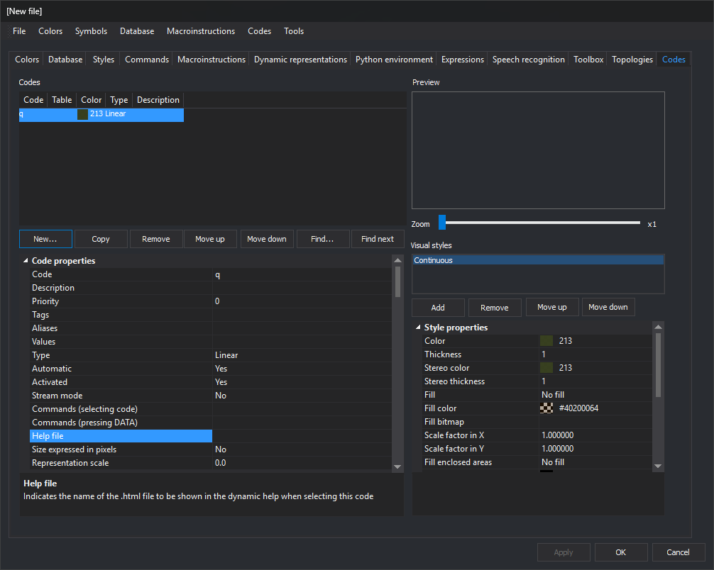
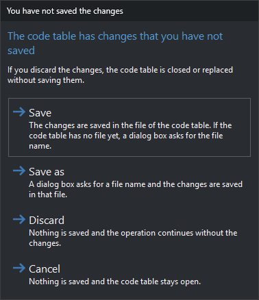

# Code table editor
<!-- id: editor-de-tablas-de-codigos -->
<!-- origen: 9c475187ecc3dc975219714b80200ad49ca1fe3a -->

The code table editor (DigiTab) creates and edits code tables (`.tab.xml`). Its window has a [menu bar](menus/README.md), a row of [tabs](pestanas/README.md), and three buttons.

## Buttons

* **Apply**: apply changes from the visible tab to the code table. Enabled when that tab has unapplied changes.
* **OK**: apply pending changes from all tabs; if the table has unsaved changes, display [You have not saved the changes](#you-have-not-saved-the-changes), then close. **Database**, **Styles**, and **Codes** ask before applying their changes.
* **Cancel**: close without applying or saving changes.

When changing tabs, **Colors** and **Topologies** apply their changes; **Database**, **Styles**, and **Codes** ask whether to apply them. Other tabs retain unapplied changes until **Apply** or **OK**.

Applied changes belong to the open code table but are not written to its file until **File/Save**.

## You have not saved the changes

This dialog appears when the table has unsaved changes and you click **OK** or choose **New** or **Open...** in [File](menus/archivo/README.md).

* **Save**: save to the table file. If none exists yet, request a filename as with **Save as**. This is the default.
* **Save as**: request a filename and save there.
* **Discard**: save nothing and continue closing the editor, creating a table, or opening another table.
* **Cancel**: save nothing and leave the table open. **Esc** is equivalent.

Canceling file selection reopens this dialog. A file write failure displays an error and leaves the table open.
