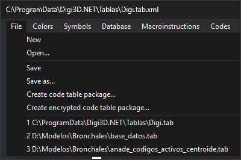
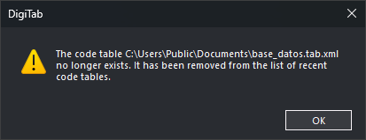

# File
<!-- id: menu-archivo-editor-tablas -->
<!-- origen: 6b1e44154a6518c51f29e9545aad99e2a7c7f5a2 -->

| Option | Action |
| :--- | :--- |
| **New** | Creates an empty code table. Unsaved changes first open [You have not saved the changes](../../README.md#you-have-not-saved-the-changes). |
| **Open...** | Opens `.tab.xml`. Unsaved changes first open [You have not saved the changes](../../README.md#you-have-not-saved-the-changes). Opening runs table [checks](../herramientas/comprobaciones.md). |
| **Save** | Saves to the table's file. For a new table, acts as **Save as...**. |
| **Save as...** | Saves to another `.tab.xml`, which becomes the table's file. |
| **Create code table package...** | Saves a copy as `.dt`. The open table retains its file association. |
| **Create encrypted code table package...** | Opens [Create Encrypted Code Table Pack](crear-paquete-cifrado.md). |
| **1**, **2**... (recent code tables) | Opens that table like **Open...**: unsaved changes first open [You have not saved the changes](../../README.md#you-have-not-saved-the-changes), then opening runs checks. A missing file displays a warning and is removed. An unavailable drive (unplugged USB or inaccessible network drive) keeps its entry and shows the loading warning. An empty list shows disabled **Recent code tables** instead. |

Before writing, **Save**, **Save as...** and both package options apply pending tab changes without **Apply**, like **OK**. Database, Styles and Codes ask whether to apply; other tabs apply without prompting.

## Recent code tables

The last 10 tables opened through **Open...** or this list, or saved through **Save as...** or [You have not saved the changes](../../README.md#you-have-not-saved-the-changes) when it requests a filename. Most recent is **1**. Reopening or saving a listed table moves it first. Paths of 260 or more characters are not added. Long menu paths are abbreviated with `...`.

Selecting a missing file or a directory displays this warning and removes the entry:

Other failures, such as an unavailable drive or missing access permission, retain the entry.

The list is saved for your Windows user across editor sessions.
