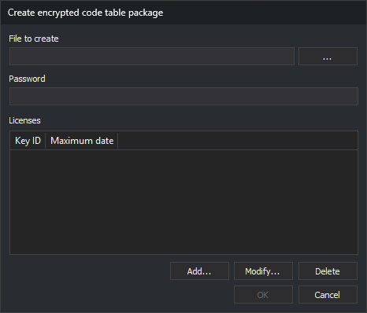

# Create Encrypted Code Table Pack
<!-- id: crear-paquete-cifrado -->
<!-- origen: 5f94bf4c925d35f7b8a5721dcf96f4b189213922 -->

This **File** option creates an encrypted `.dt` code table package. Digi3D.AI loads it only on a computer with a dongle listed in Licenses and before that license's maximum date. An unlisted dongle or a computer date after the maximum causes an error and prevents loading.

## Controls

* **File to create**: package path. **...** opens **Save as** with **Code table package (\*.dt)**.
* **Password**: table encryption password.
* **Licenses**: **Key ID** and **Maximum date** columns.
* **Add...**: opens **Add license**, requesting the dongle KeyID and a calendar date. Entering KeyID enables **OK**. An existing KeyID's date is replaced.
* **Modify...**: opens **Add license** with selected license data. Accepting replaces that license's data.
* **Delete**: deletes the selected license.

**OK** requires a file, password and at least one license. Clicking writes the package; a write failure displays an error.

Creating a package does not save the open code table: closing the editor still asks to save a changed table.
