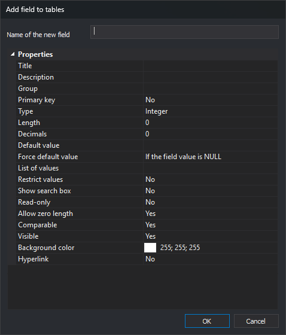

# Add field to tables
<!-- id: anadir-campo-a-tablas -->
<!-- origen: ff86f85a2336033408a34b1919f0a8bc6a414e61 -->

Opened by **Database/Fields/Add a field to all tables...**. Adds the same field to tables lacking that name.

## Controls

* **Name of the field to be added**: a table with that field name, ignoring case, is unchanged.
* **Properties**: same as [Field properties](../../pestanas/base-de-datos/propiedades-de-los-campos.md) under Database, except **Copyable**, which is not offered.
* **OK**: adds the field. An empty name leaves the dialog open.
* **Cancel**: closes without changes.

The field is appended to each table. If any changes, the selected **Database** table is reloaded.
