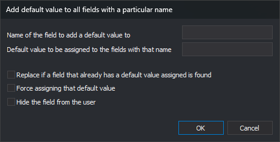

# Add default value to all fields with a particular name
<!-- id: asignar-valor-defecto-campos -->
<!-- origen: f681b700084100801aa1e52816f3eb7dbbd7cdbf -->

Opened by **Database/Fields/Assign a default value to all fields with a particular name...**. Assigns the same default to matching fields in all tables.

## Controls

* **Name of the field to add a default value to**: matched case-insensitively.
* **Default value to be assigned to the fields with that name**: assigned to **Default value**.
* **Replace if a field that already has a default value assigned is found**: when cleared, preserves existing defaults.
* **Force assigning that default value**: sets **Force Default Value** to **Always** when selected, or **If the field value is NULL** when cleared.
* **Hide the field from the user**: sets **Visible** to **No** when selected, or **Yes** when cleared.

**OK** changes matching fields in every table, except existing defaults when replacement is cleared. **Cancel** closes without changes.

See [Field properties](../../pestanas/base-de-datos/propiedades-de-los-campos.md).
