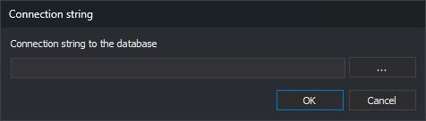

# Connection string
<!-- id: cadena-de-conexion -->
<!-- origen: 35863d42dcc345bc0229d9a236e77bbe348fa089 -->

Opened by **Database/Tables/Import a database schema in Geographics format...** and **Import a database schema in CATDBS format...**. Requests the OLE DB connection string for the database whose schema will be imported.

## Controls

* **Connection string to the database**: OLE DB connection string.
* **...**: opens the Windows Data Link wizard. Its generated string replaces the field contents.
* **OK**: connects and imports the schema.
* **Cancel**: closes without importing.

## Result

Accepting reads database tables and creates each with its fields. Each primary key field is marked as such and hidden. Field descriptions come from the database.

Imported tables replace all code table tables. A table opening failure offers retry, skip or cancel in a task dialog.

A failed connection displays an error and preserves tables.
