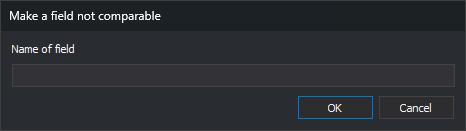

# Make a field non-comparable
<!-- id: campo-no-comparable -->
<!-- origen: 8b1dff897126b3f96f2082940ae8cacebd431f24 -->

Opened by **Database/Fields/Make a given field "Not comparable" in all the tables in which it appears...**.

Requests **Field name**. Accepting sets **Similar** to **No** for that field in every table, ignoring case. A non-comparable field is excluded when comparing attributes to decide whether records are identical.

No matching fields means no changes. **Cancel** closes without changes.

See [Field properties](../../pestanas/base-de-datos/propiedades-de-los-campos.md).
