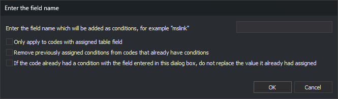

# Enter the field name
<!-- id: condicion-campo-igual-codigo -->
<!-- origen: 3470b42de98bc0f3d65bf2c50e0c9fb12293f2c0 -->

Opened by **Database/Codes/Automatically add a condition to the table of each code of the type [field]=[code name]**. Adds `campo=código` to each code's [Conditions](../../pestanas/codigos/base-de-datos.md#conditions).

For example, field `mslink` gives code `010101` condition `mslink=010101`.

## Controls

* **Enter the field name which will be added as conditions, for example "mslink"**: field name.
* **Only apply to codes with assigned table field**: leaves codes without tables unchanged.
* **Remove previously assigned conditions from codes that already have conditions**: clears old conditions before adding the new one.
* **If the code already had a condition with the field entered in this dialog box, do not replace the value it already had assigned**: preserves an existing condition for that field. When cleared, its value becomes the code name.
* **OK**: changes codes and reloads Codes.
* **Cancel**: closes without changes.
