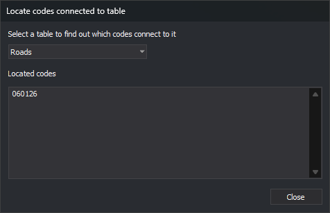

# Locate codes connected to table
<!-- id: localizar-codigos-enlazan-tabla -->
<!-- origen: b763af697b554cabd346af57939004b3184d7a46 -->

Opened by **Database/Codes/Locate all codes which connect to a particular table...**. Lists codes whose **Table** is the selected table.

## Controls

* **Select a table to find out which codes connect to it**: alphabetical code table table list. Selection updates results.
* **Located codes**: one per line. Table name comparison ignores case.
* **Close**: closes without code table changes.
