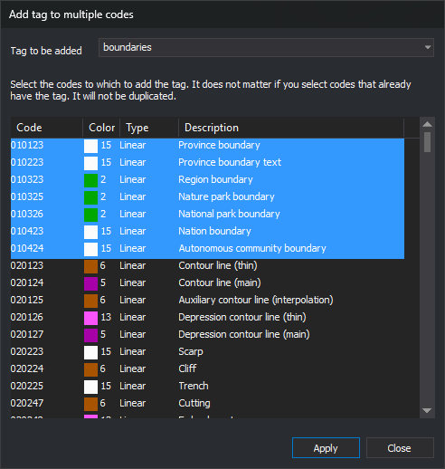

# Add tag to multiple codes
<!-- id: anadir-etiqueta-a-multiples-codigos -->
<!-- origen: f9513a8b5c100b78e9db7dc7187888a2efeb17bf -->

Opened by **Codes/Add tag to multiple codes...**. Adds a [tag](../../pestanas/codigos/propiedades-del-codigo.md#tags) to several codes at once.

## Controls

* **Tag to be added**: enter a new tag or select an existing code table tag.
* **Code list**: **Code**, **Color**, **Type** and **Description** columns. Select codes to tag; multiple selection is supported. Existing tags are not duplicated.
* **Apply**: tags selected codes and clears **Tag to be added**. Remains open for another tag.
* **Close**: closes.

The resizable dialog remembers size and position.
