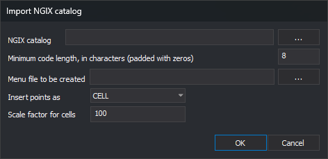

# Import NGIX catalog
<!-- id: importar-catalogo-ngix -->
<!-- origen: e99b8e210cf8f24a018093cd216ca1f267e72882 -->

Opened by **Codes/Import NGIX catalog...**. Creates codes from a `.cat` NGIX catalog's `features` section and writes a [Toolbox](/digi3d-ai/referencia/paneles/cuadro-de-herramientas.md) menu with them.

## Controls

* **NGIX Catalog**: `.cat` file. **...** opens **Open**.
* **Minimum number of characters for codes (0's will be added at left of code name)**: minimum code width. Default: 8, so `1203` becomes `00001203`.
* **Menu file to be created**: output `.menu.xml`. **...** opens **Save as**.
* **Insert points as**: DGN element type for codes with cells: **CELL** or **SHARED_CELL**.
* **Scale factor for cells**: DGN cell translation scale. Default: 100.
* **OK**: imports.
* **Cancel**: closes without importing.

## Result

For each catalog code, the editor:

* Creates the code with catalog description, color and type; a cell also creates a symbol style named `Estilo_<célula>`.
* Fills DGN translation parameters with catalog level, color, line style, weight and cell.
* Adds a menu group per catalog section, with a code option running `cod=<código>`.

Messages:

* **The features section was not found**: no `features` section.
* **Error creating the menu file**: cannot write `.menu.xml`.
* **Unexpected end of file**: catalog ends before closing sections.
* **File imported successfully**: import complete.
