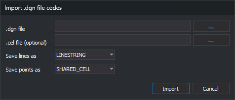

# Import .dgn file codes
<!-- id: importar-codigos-dgn -->
<!-- origen: fe2f9a0d3ffda066fd65ca3d76c1d3cc30f67298 -->

Opened by **Codes/Import .dgn file codes...**. Creates codes from MicroStation DGN levels and optionally `.cel` library cells.

## Controls

* **.dgn file**: levels to import. **...** opens **Open**.
* **.cel file (optional)**: cell library. **...** opens **Open**.
* **Save lines as**: DGN element type for created line codes: **LINE**, **LINESTRING** or **SHAPE**.
* **Save points as**: DGN element type for point codes from cells: **POINT**, **CELL** or **SHARED_CELL**.
* **Import**: creates codes.
* **Cancel**: closes without importing.

## Result

* A supplied `.cel` first creates a point code per cell, named after it, and a style using it as a symbol.
* Then each DGN level absent from the code table creates a line code with the level's name, description, color, weight and line style.

New styles are appended to **Styles** and codes to **Codes**.

The DGN extension performs import. If none supports it, the editor displays **No extension able to import codes from a MicroStation DGN file was found.** Unreadable files display their error.
