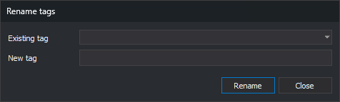

# Rename tags
<!-- id: renombrar-etiquetas -->
<!-- origen: 6d1a9dc6fa10ca68796206e205926579d94ada7b -->

Opened by **Codes/Rename tags...**. Renames a [tag](../../pestanas/codigos/propiedades-del-codigo.md#tags) on every code using it.

## Controls

* **Existing tag**: alphabetical code table tags.
* **New tag**: replacement name.
* **Rename**: replaces the tag on all codes. Does nothing if either field is empty or names differ only in case. Reloads the drop-down and stays open.
* **Close**: closes. Codes refreshes if any tag was renamed.
