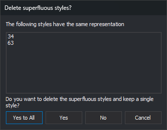

# Tests
<!-- id: comprobaciones-editor-tablas -->
<!-- origen: 41b0d257d01812c0506b5368d0bb0aebc4184f09 -->

**Tools/Tests** finds code table problems. All checks also run on opening a code table.

| Option | Checks |
| :--- | :--- |
| **All** | Runs the following checks in order. |
| **Styles/Invisible symbols** | Symbol styles with zero X or Y scale. Offers correction: zero scale factors and distance become 1. |
| **Styles/Nonexistent symbols** | Point codes with no symbol style in their representations, making them invisible. Lists only. |
| **Styles/Same styles** | Identical representations. See [Delete superfluous styles?](#delete-superfluous-styles). |
| **Styles/Styles not used** | Styles unused by codes. Offers deletion. |
| **Codes/Codes with nonexistent styles** | Representations referencing absent styles. Offers replacement through [Select style](../../pestanas/selecciona-el-estilo.md). |
| **Database/Nonexistent tables** | Codes' **Table** references absent from Database. Lists only. |
| **Database/Tables with no primary key** | Tables without primary keys. Lists only. |
| **Database/Tables with multiple primary keys** | Tables with multiple primary key fields. Lists only. |
| **Database/Tables whose primary key is not of the type "numeric"** | Non-numeric primary keys. Lists only. |

Each check displays a message only if it finds a problem.

Before **Invisible symbols**, **Same styles** or **Styles not used**, the editor asks whether to apply or discard pending **Styles** and **Codes** changes. Deleting styles reloads both tabs.

## Delete superfluous styles?

**Same styles** opens this dialog per identical representation group. **The following styles have the same representation** lists it: the first is retained, subsequent styles are redundant.

* **Yes to All**: deletes redundant styles in this and following groups without further prompts.
* **Yes**: deletes redundant styles in this group.
* **No**: keeps this group and proceeds.
* **Cancel**: stops checking. Already deleted styles are not restored.

Code representations using a removed style are reassigned to the retained style.
