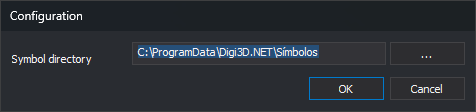

# Configuration
<!-- id: configuracion-editor-tablas -->
<!-- origen: 4711e2eaa609fcd37d41f871126e865956a16342 -->

**Tools/Configuration...** opens this dialog. Creating a table also opens it if no symbol folder is configured.

## Controls

* **Symbol directory**: `.bin` symbols used by styles. Used for drawing styles in **Styles**, **Codes** and **Select symbol**. **...** opens folder selection.
* **OK**: saves the folder in the user's Windows registry.
* **Cancel**: closes without changing it.
