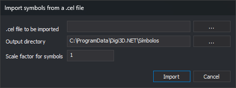

# Import symbols from a .cel file
<!-- id: importar-simbolos-cel -->
<!-- origen: 2191cb71d02ee2160e3699fba04bbcd838f397fc -->

This **Symbols** option converts MicroStation cell library (`.cel`) cells to Digi3D.AI symbols: one `.bin` drawing per cell.

## Controls

* **.cel file to be imported**: cell library. **...** opens **Open** with **MicroStation cell files**.
* **Output directory**: destination symbol folder. Defaults to the symbol folder in [Configuration](../herramientas/configuracion.md). **...** opens folder selection.
* **Scale factor for symbols**: factor applied to cell coordinates. Default: 1.
* **Import**: runs conversion.
* **Cancel**: closes without importing.

The DGN import extension converts cells. If no loaded extension supports it, the editor displays **No extension able to import symbols from a MicroStation CEL file was found.**

Styles use imported symbols only if the output folder is the configured symbol folder.
