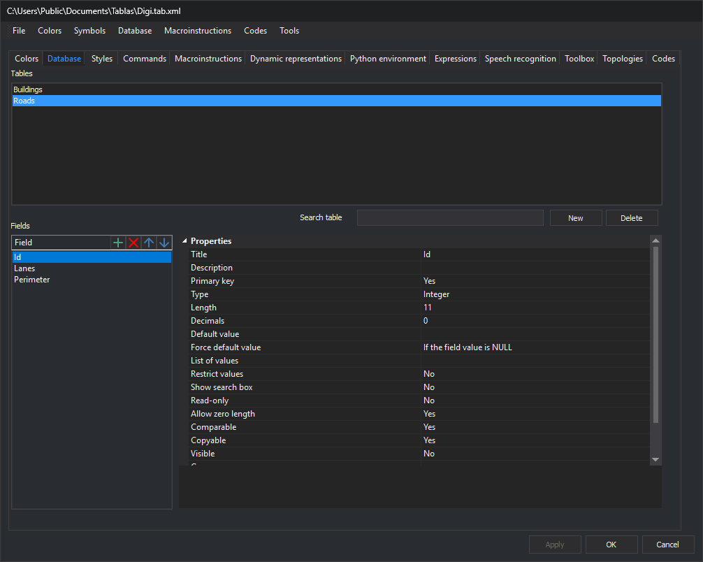
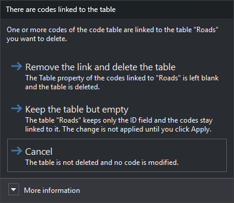
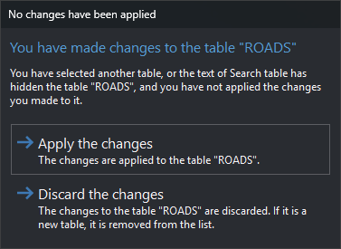
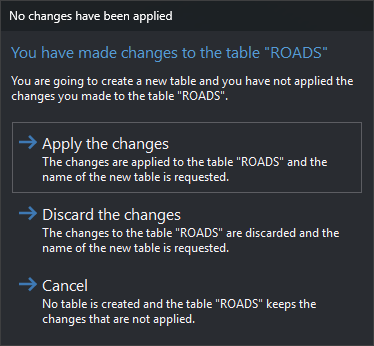
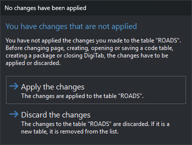

# Database
<!-- id: base-de-datos-3 -->
<!-- origen: b0cea95cd75a94d4cb6ce6d6ed59fbb5afe06c8b -->

This tab configures database tables and fields. Each code can link to a table through [Table](../codigos/base-de-datos.md#table).

## Tables

Tables defined in the code table.

* **Search table**: filters names case-insensitively. Empty shows all tables. Hiding the edited table loads the first visible table; unapplied changes first open [No changes have been applied](#selecting-another-table). If the list refreshes for another reason, such as table creation from Database, the edited table remains even if it does not match. A new unapplied table is always shown.
* **New**: requests a name and creates a table with an `ID` primary key field. Added to the code table when changes are applied.
* **Remove**: deletes the selected table. A new unapplied table is removed from the list. Codes linking to it open [There are codes linked to the table](#there-are-codes-linked-to-the-table).

### There are codes linked to the table

Appears with **Remove** when codes reference this table through [Table](../codigos/base-de-datos.md#table). Contents show its name.

* **Remove the link and delete the table**: clears those codes' **Table** and deletes the table from the code table.
* **Keep the table but empty**: removes fields, leaving a new `ID` alone. Codes remain linked. Changes wait for **Apply**.
* **Cancel**: preserves table and codes. Default button; Esc has the same effect.

**More information** explains that deleting without unlinking would leave codes pointing to a nonexistent table.

## Fields

Selected table's fields. Four toolbar buttons:

* **New** (+): adds a field. Enter its name in the list.
* **Remove** (x): deletes the selected field.
* **Up** and **Down** (arrows): reorder it.

Selecting a field shows its [properties](propiedades-de-los-campos.md) on the right.

## Apply changes

Selected table changes apply with **Apply** or **OK**. With unapplied changes, the editor asks what to do when selecting another table, clicking **New** or changing pages. In dialogs without **Cancel**, Esc means **Discard the changes**.

### Selecting another table

Appears when another table is selected or **Search table** hides the changed table. Clicking the same table again does not prompt.

* **Apply the changes**: applies and loads the selected table. Default button.
* **Discard the changes**: discards and loads the selected table. A new table is removed from the list.

### Clicking New

**New** adds **Cancel** to the preceding choices:

* **Apply the changes**: applies and requests the new table name.
* **Discard the changes**: discards and requests the new table name.
* **Cancel**: creates no table and retains unapplied changes. Esc has the same effect.

### Changing pages

Appears when switching tabs and before operations applying all tabs: **OK** and **New**, **Open...**, **Save**, **Save as...** or package creation under [File](../../menus/archivo/README.md).

* **Apply the changes**: applies table changes. Default button.
* **Discard the changes**: discards and reloads the table. A new table is removed from the list.

Either button continues the tab change or operation.

[Database](../../menus/base-de-datos/README.md) includes operations affecting all tables.
