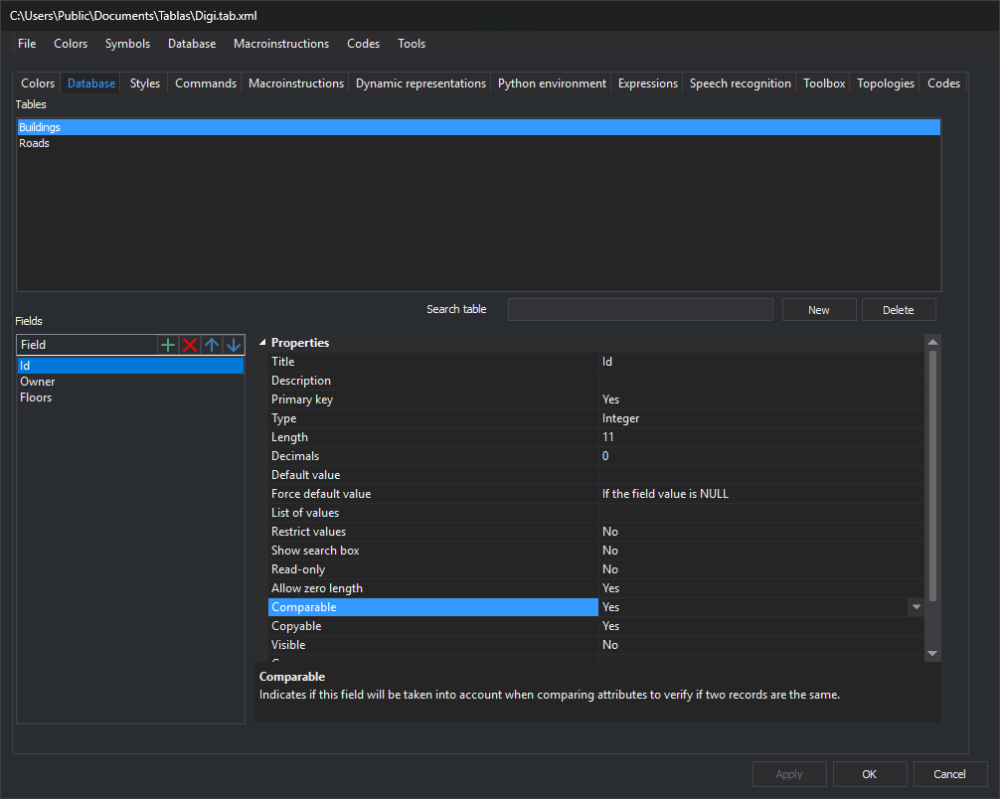
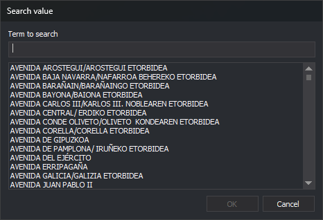

# Field properties
<!-- id: propiedades-de-los-campos -->
<!-- origen: f48b57005638d4c4707f5659bdae9beaaaf88562 -->

This category configures database field properties.



## Title

Field name displayed to users in windows such as [Database fields](/digi3d-ai/referencia/paneles/campos-de-la-base-de-datos.md).

Usually matches the field name, but need not.

## Description

Description shown below the property grid in database field windows.

Clicking a field shows its description.

## Main key

Whether this field is the table's primary key.

## Type

Information stored in this field for each record:

* **Character string**: text.
* **Whole number**: integers.
* **Real number**: real numbers.
* **Date**: dates.

## Length

Field length, always greater than 0 and large enough for its data.

## Decimals

Number of decimal places when **Type** is **Real number**.

Relevant to XBASE databases \(used by Shapefiles\), which store numbers as text.

Not relevant to databases such as Access, where real fields store _double_ values with all decimal places.

## Default value

Optional constant or [database macro](macros-de-base-de-datos.md).

## Force Default Value

Always stores [Default value](propiedades-de-los-campos.md#default-value), regardless of the user's entry in [Database fields](/digi3d-ai/referencia/paneles/campos-de-la-base-de-datos.md).

## List of values

Possible values for this field.

With a list, windows such as [Database fields](/digi3d-ai/referencia/paneles/campos-de-la-base-de-datos.md) show a drop-down for choosing a value.

Values can be stored directly in the code table or retrieved dynamically by SQL against the loaded database.

### Direct values

Enter as many as needed, each with title and description separated by \| \(AltGr + 1 enters this character\).

`[valor]|[título]|[descripción]`

* Value is stored in the database.
* Title appears in the drop-down. It may differ from the stored value to identify the choice.
* Description appears below the database input window, such as [Database fields](/digi3d-ai/referencia/paneles/campos-de-la-base-de-datos.md), when the field is selected.

#### Example:

To store “1” for high woodland and “2” for scrubland, enter:

```text
1|Monte alto|El tipo de vegetación de esta parcela es monte alto|2|Monte bajo|El tipo de vegetación de esta parcela es monte bajo
```

### SQL query

Enclose a selection query in percent signs:

```sql
%SELECT IdCalle, NombreCalle FROM CALLES%
```

The application reads query fields:

* A single returned field supplies both value and displayed text for each record.
* With multiple fields, the first supplies the value and the second the displayed text.

## Restrict values

If a value list exists, prevents manually entering values in the drop-down.

## Show search box

With **Yes**, **...** appears beside the drop-down and opens **Search value**.

It appears only when all conditions hold:

* The field is character or numeric. Real and date fields do not show it even with **Yes**.
* The field has a [List of values](#list-of-values). Without one, this property is not saved in the code table.
* A `%SELECT ...%` list query executes successfully. Failure shows a text box with the stored value instead.
* The field is visible and is not the primary key.

Available in property-grid windows: [Database fields](/digi3d-ai/referencia/paneles/campos-de-la-base-de-datos.md), [Properties of selected entity](/digi3d-ai/referencia/paneles/propiedades-de-la-entidad-seleccionada.md), [Code editor](/digi3d-ai/referencia/ventana-de-dibujo/ordenes/e/editar-cod.md#code-editor-dialog) and [Error in user attributes](/digi3d-ai/referencia/cuadros-de-dialogo/error-en-los-atributos-de-usuario.md). [Database editor](/digi3d-ai/referencia/paneles/editor-de-la-base-de-datos-1-2-3-4.md) uses a table and has no such button.

### Search value dialog



* **Term to search**: filters value titles case-insensitively, in alphabetical order.
* **List**: initially all titles. Selecting one enables **OK**.
* **OK**: assigns the selected title's value to the field.
* **Cancel**: closes without changing it.

## Read-only

Prevents editing the displayed field value.

## Allow length 0

Whether users may leave the field empty.

## Similar

Commands such as [CONNECT](/digi3d-ai/referencia/ventana-de-dibujo/ordenes/u/unir.md) join database-linked lines only when both codes and database attributes match.

A perimeter attribute prevents _CONNECT_ from joining lines with different perimeters even if all other attributes match. To join them, exclude that field from comparison.

Similar marks a field as non-comparable. In this example, _CONNECT_ ignores perimeter when deciding whether the geometries can be joined.

## Copyable

Whether [COPY](/digi3d-ai/referencia/ventana-de-dibujo/ordenes/c/copiar.md) copies this field value when copying a geometry.

## Visible

Whether the field appears in the user interface, for example [Database fields](/digi3d-ai/referencia/paneles/campos-de-la-base-de-datos.md).

## Group

Optional group name. Windows displaying database fields create categories \(named here\) and place this field within them.

Groups bring related fields together in the interface.

## Background color

Background used when displaying this field.
