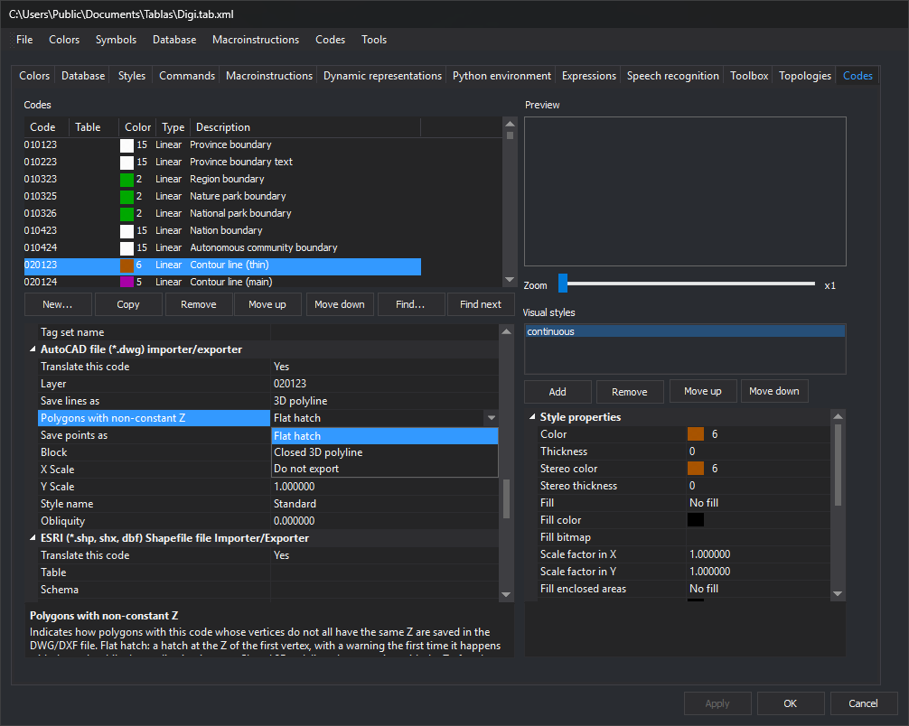
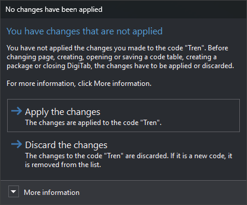

# Codes
<!-- id: codigos -->
<!-- origen: e9034176fc7efc71e365f6e3e1d5f9a5638c685c -->

This tab configures code table codes and their representations.

## Code list

**Codes** has one row per code, with **Code**, **Table**, **Color** (first representation's color number and swatch), **Type** and **Description**. Its context menu moves the selected code up, down, to the beginning or to the end.

List buttons:

* **New...**: opens **New Code**, requesting a name and warning if it already exists.
* **Copy**: creates a code with the selected code's properties, requesting its name in the same dialog.
* **Remove**: deletes the selected code without confirmation.
* **Scroll up** and **Scroll down**: change the selected code's position.

**Remove**, **Scroll up**, **Scroll down** and context menu options modify the code table immediately, without **Apply**.
* **Search for...**: opens **Search**, finding a code by name. **Allow searching by description**, **Match case** and **Whole words only** adjust matching.
* **Search next**: finds the next match with the same criteria.

## Code properties

The lower-left grid shows selected code properties in these categories:

* [Code properties](propiedades-del-codigo.md).
* [Database](base-de-datos.md).
* **Quality control**: **Analyze quality control when digitizing** and **Quality controls to apply**, opening **Quality controls**.
* One category per importer/exporter translating codes, such as **AutoCAD file (\*.dwg) importer/exporter** or **ESRI Shapefile (\*.shp, shx, dbf) importer/exporter**, containing that format's code translation parameters. See each format under [Importers and exporters](/digi3d-ai/referencia/ventana-de-dibujo/importadores-y-exportadores/README.md); for example, **Polygons with non-constant Z** in the image is described under [DWG](/digi3d-ai/referencia/ventana-de-dibujo/importadores-y-exportadores/dwg.md) and also applies to DXF.

## Preview and visual styles

**Preview** draws the selected code with its representations. **Zoom** changes drawing scale.

**Visual styles** lists the code's representations. A geometry with this code is drawn with every representation, in list order.

* **Add**: opens [Select style](../selecciona-el-estilo.md) and adds a representation with that style.
* **Remove**: deletes the selected representation.
* **Scroll up** and **Scroll down**: reorder it.

Selecting a representation shows color, weight, stereo color and weight, fill and other properties under **Style properties**. **...** beside color properties opens [Select color](../../../cuadros-de-dialogo/seleccionar-color.md) with the code table palette.

### Text with TrueType fonts

These representation properties control code text:

* **Font**: **TrueType** draws text with **TrueType font**. A number selects that Digi font.
* **TrueType font**: name of an installed _Windows_ TrueType font.
* **Fill TrueType fonts**: **Yes** fills TrueType text in the photogrammetric window; **No** draws character outlines only. Fill and outline use the same color. Default: **Yes**. The drawing window always fills TrueType text, regardless of this property.

[PointCloud](/digi3d-ai/referencia/ventana-fotogrametrica/sensores/point-cloud.md) and [Stereoscopic orthophoto](/digi3d-ai/referencia/ventana-fotogrametrica/sensores/ortofoto-estereoscopica.md) draw text with the code's first representation and use that representation's **Fill TrueType fonts**. Other sensors use each representation's value.

## Apply changes

Selected code changes apply with **Apply**, **OK** or when selecting another code: the latter applies without asking.

### Creating, copying or moving a code

With unapplied changes, **New...**, **Copy**, **Scroll up** or **Scroll down** opens **No changes have been applied**:

* **Apply the changes**: applies code changes. Default button.
* **Discard the changes**: discards changes; a new code is removed from the list. Esc selects this button.

**New...** and **Copy** then continue to request a name; **Copy** stops if the discarded code was new, since it no longer exists. **Scroll up** and **Scroll down** do not move the code: select it again and click the button.

### Changing pages

Appears with unapplied code changes when switching tabs, clicking **OK** or selecting **New**, **Open...**, **Save**, **Save as...** or a package creation option under [File](../../menus/archivo/README.md).

* **Apply the changes**: applies code changes. Default button.
* **Discard the changes**: discards changes; a new code is removed. Esc selects this button.

**More information** explains that other pages' changes, such as a visual style name, may affect codes. Either button continues the tab change or operation and clears property grids.

[Codes](../../menus/codigos/README.md) imports codes from other formats and operates on several codes at once.
