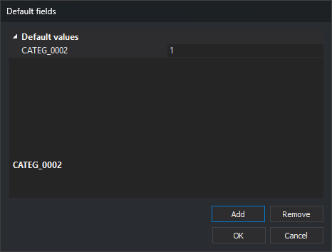
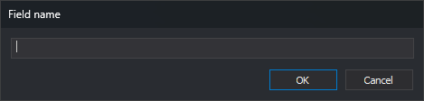

# Database
<!-- id: base-de-datos-4 -->
<!-- origen: d3b3cf7954c5ba7c901e33fcf25654d7d2780774 -->

This category configures the code's database relationship.

## Table

Select the table whose attributes appear in panes such as [Database fields](/digi3d-ai/referencia/paneles/campos-de-la-base-de-datos.md) when this code is active.

The drop-down lists tables added under [Database](/digi3d-ai/referencia/editor-de-tablas-de-codigos/pestanas/base-de-datos/README.md).

## Default values

Values assigned to database fields of geometries digitized with this code. The property shows the first `campo=valor` pair, followed by `...` if more exist.

**...** opens **Default fields**:



* **Default values**: one field and value per row. Enter values on the right.
* **Add**: opens **Field name**, requesting a name and adding an empty-valued row. Checks neither table membership nor list duplicates.
* **Remove**: deletes the selected field. Enabled with a selected field.
* **OK** saves; **Cancel** preserves the previous list.



## Conditions

Conditions a database record must meet for its geometry to receive this code.

This optional field applies only to GIS files such as Shapefiles.

For example, a Shapefile has an _Edificaciones_ table with a _Tipo_ field:

| Value | Meaning |
| :--- | :--- |
| 0 | Building under construction |
| 1 | Private building |
| 2 | Public building |

Suppose the code table has these codes:

| Code | Description |
| :--- | :--- |
| 010101 | Building under construction |
| 010102 | Private building |
| 010103 | Public building |
| 010104 | Other buildings |

Selecting _Edificaciones_ in each code's [Table](base-de-datos.md#table) would leave the Shapefile importer unable to choose among 010101, 010102, 010103 and 010104 for its geometries.

**Conditions** resolves this.

For 010101, enter:

```text
Tipo=0
```

For 010102:

```text
Tipo=1
```

For 010103:

```text
Tipo=2
```

Leave **Conditions** empty for 010104.

A geometry with Tipo = 1 then receives code 010102.
