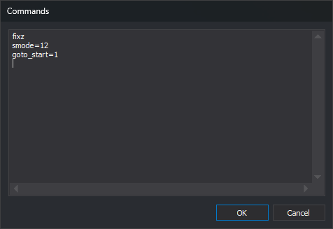
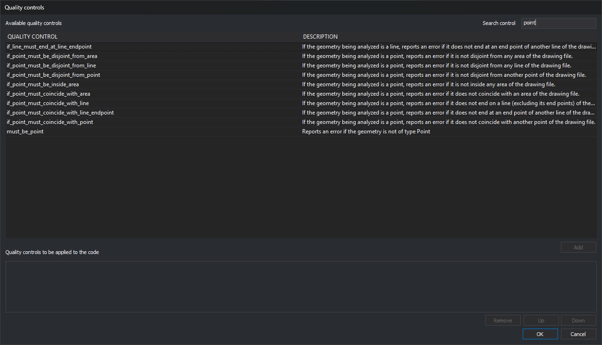
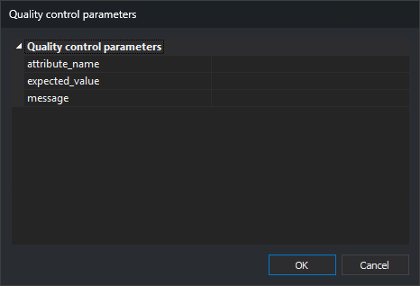

# Code properties
<!-- id: propiedades-del-codigo -->
<!-- origen: bfd7781c9ce72206597642e7137d27a8ab955cc6 -->

This category configures code properties.

## Code

Code name.

The name identifies the code and must be unique within the code table. Pass it to commands such as [COD+](/digi3d-ai/referencia/ventana-de-dibujo/ordenes/c/cod-mas.md).

## Description

Code description, for example _Index contour_.

## Priority

Commands such as [BINTRAM](/digi3d-ai/referencia/ventana-de-dibujo/ordenes/b/bintram.md) merge duplicate geometries into one multi-code geometry. If codes have values in this field, they are sorted in the resulting geometry by this priority.

## Tags

Tags associated with the code.

Tags group codes, replacing the old _code table_ files (text files with one line per code).

A code can have:

* No tags.
* One or more tags.

Separate multiple tags with commas.

For example, to assign _planimetría_, _viales_ and _carreteras_, enter:

```
planimetría, viales, carreteras
```

Prefix a tag with a hash (#) to pass it to a command supporting tags.

For example, [OFF](/digi3d-ai/referencia/ventana-de-dibujo/ordenes/o/off.md) hides geometries with the supplied code. It also accepts a tag instead of a code. To hide all geometries tagged “_viales_”, run:

```
off=#viales
```

### Dynamic menus

Digi3D.AI shows active code table tags in menus such as **View**. These menus run commands on all geometries having a code associated with the selected tag.

For **View**, if the active code table has codes tagged _Vegetación_, View includes _Vegetación_. Selecting it enables display of all geometries whose codes have that tag.

## Aliases

Optional alternative names for this code.

For example, add alias “fina” to code “020123” and run:

```
cod=fina
```

[COD+](/digi3d-ai/referencia/ventana-de-dibujo/ordenes/c/cod-mas.md) automatically selects “020123”.

## Values

Optional value dictionary associated with the code, with as many values as required.

Enter `propiedad=valor` pairs, separated by commas for multiple values.

For example, to assign “ancho” = “13” and “categoría” = “002”, enter in Values:

```
ancho=13, categoría=002
```

Use these values with the [database macro](../base-de-datos/macros-de-base-de-datos.md) `%CENTROID_VALUE=[valor]%`.

## Type

Geometry type represented by the code:

* **Linear**: intended for lines.
* **Point-based**: intended for points.
* **Virtual**: intended for drawing geometries without storing them in a drawing file.

Type does not restrict what you can draw. For example, a code set to _Point-based_ can still draw a circle with [CIR2P](/digi3d-ai/referencia/ventana-de-dibujo/ordenes/c/cir2p.md).

Type determines which command is [run automatically](/digi3d-ai/referencia/ordenes/formas-de-ejecutar-una-orden/de-manera-automatica/) when the program is in [ready mode](/digi3d-ai/referencia/ordenes/formas-de-ejecutar-una-orden/de-manera-automatica/modo-preparado.md) and you press Data in the drawing window.

## Automatic

Whether pressing Data in the drawing window [runs a command automatically](/digi3d-ai/referencia/ordenes/formas-de-ejecutar-una-orden/de-manera-automatica/) when this code is active and the program is in [ready mode](/digi3d-ai/referencia/ordenes/formas-de-ejecutar-una-orden/de-manera-automatica/modo-preparado.md).

Options:

* **Yes**: triggers automatic commands.
* **No**: does not trigger automatic commands.

## Activated

Whether this code can be selected to digitize new entities.

Disabling Activated still allows displaying and recognizing existing geometries, but prevents creating new ones with this code.

Options:

* **Yes**: can be selected to digitize new entities.
* **No**: cannot be selected to digitize new entities.

## Stream mode

Whether this code is intended for continuous line digitizing.

Geometries such as contour lines are commonly digitized continuously by holding the Data button or pedal while digitizing.

This option tells [LINE](/digi3d-ai/referencia/ventana-de-dibujo/ordenes/l/linea.md) whether to add line segments.

## Command (selecting code)

Commands to run when the code is selected.

## Commands (press data)

Commands to run when Data is pressed while this code is active.

### Commands dialog

**...** in either command property opens **Commands**, with one command per line. **OK** saves lines after trimming leading and trailing spaces. The property shows the first command, followed by `...` if more exist.



## Help file

Help filename displayed in [Dynamic help](/digi3d-ai/referencia/paneles/ayuda-dinamica.md) when this code is selected.

The file must exist in the configured [user help directory](/digi3d-ai/referencia/cuadros-de-dialogo/configuracion/comunicacion-con-el-usuario/directorio-de-ayudas-de-codigos.md).

## Size expressed in pixels

With **Yes**, text and points with this code are drawn with their height in pixels: zoom does not change screen size.

## Representation scale

Denominator of the smallest display scale at which geometry is drawn. With 5000, it appears at 1:5000 and larger scales such as 1:2000, but not smaller scales such as 1:10000. With 0, always drawn.

## Quality control

Two properties:

* **Analyze quality control when digitizing**: with **Yes**, digitizing a geometry with this code analyzes quality controls involving the code. Assigned controls always run through the **Quality control** menu, regardless of this property.
* **Quality controls to apply**: opens **Quality controls**, assigning functions from [Python environment](../entorno-python.md). See [Python quality controls](/digi3d-ai/programacion/python/controles-de-calidad/README.md).

### Quality controls dialog



* **Search control**: filters **Available quality controls** to functions whose names contain the entered text, ignoring case and accents. Empty shows all functions. It does not filter assigned controls: **OK** preserves added controls even when the search hides their functions. Selection is retained until hidden by the filter; then it is cleared and **Add** is disabled. Enter in this field does not close the dialog.
* **Available quality controls**: functions and descriptions. **Add** or double-click adds the selected function to the lower list.
* **Quality controls to be applied to the code**: assigned functions in application order. **Remove** removes one; **Up** and **Down** reorder them.
* **OK** saves the property as one function per line. The resizable dialog remembers size and position.

### Quality control parameters dialog



If the added function has parameters, **Add** opens this dialog with one row per parameter. **OK** adds the function with a Python dictionary of values, for example `atributo_bbdd_debe_ser_igual({"nombre_atributo":"TIPO", "valor_esperado":3, "mensaje":"Tipo incorrecto"})`. Python numbers containing digits and at most one decimal point (`3`, `0.5`, `.5`, `2.`) are unquoted. Everything else, including empty values and integers with leading zeros such as `007`, is quoted, with backslashes and double quotes escaped.
