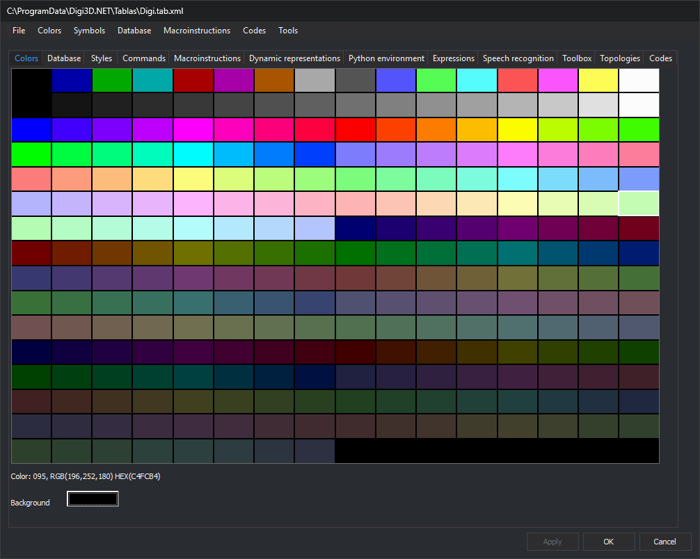

# Colors
<!-- id: colores -->
<!-- origen: e03e56c14e8f3c72ec9495b39315d8c7bbe87071 -->

This tab configures the code table's 256-color palette and the drawing window background. Code styles refer to colors by palette number.

## Color palette

The upper palette has 16 rows of 16 colors, numbered 0 to 255 from left to right and top to bottom.

* Hovering over a color shows its number and value below, for example `Color: 095, RGB(196,252,180) HEX(C4FCB4)`.
* Clicking opens color selection. Accepting changes that palette entry.

## Background color

**Background color** shows the background used when opening a drawing window with this code table. Click it to open color selection. [BACKGROUND\_COLOR](/digi3d-ai/referencia/ventana-de-dibujo/variables/c/color-fondo.md) changes the color during the session.

## Colors menu

| Option | Action |
| :--- | :--- |
| **Import...** | Replaces the palette with one from another file: a code table (`.tab.xml`), Digi21 palette (`.pal`, one `R G B` color per line) or MicroStation color table (`.tbl`). In a `.tbl`, the first color goes to entry 255 and subsequent colors to entries 0 through 254. Background becomes black. |
| **Restore** | Restores the palette from when the code table was opened, without changing the background. |
| **Digi Standard** | Replaces the palette with Digi3D.AI's standard palette and makes the background black. |
| **MicroStation standard** | Replaces the palette with MicroStation's standard palette and makes the background black. |
| **MicroStation (256 colors) standard** | Replaces the palette with MicroStation's 256-color palette and makes the background black. |

## Applying and saving changes

Changes apply to the code table when clicking **Apply**, switching tabs or clicking **OK**. Save them to the file with **File/Save**, or by clicking **OK** and accepting the save prompt.
