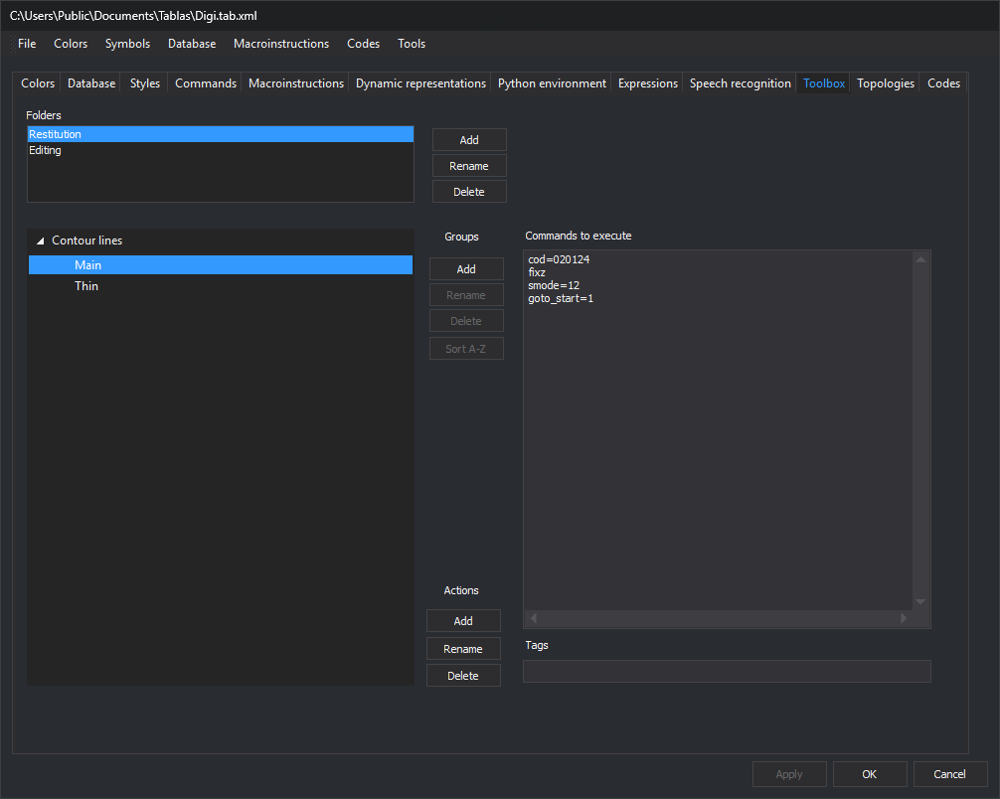

# Toolbox
<!-- id: cuadro-de-herramientas-2 -->
<!-- origen: 7b8791e8209e76bb14f1d371f31cd2b99f01f88a -->

Configures Digi3D.AI's [Toolbox](/digi3d-ai/referencia/paneles/cuadro-de-herramientas.md) when the drawing window uses this code table. Folders contain groups, which contain actions. An action is a pane button running a command list.

## Folders

* **Folders**: code table folders.
* **Add**: requests a new folder name. Existing names are not added.
* **Rename**: opens **Rename folder** with the selected name.
* **Remove**: deletes the folder, groups and actions.

## Groups and actions

The left pane shows selected folder groups and their actions.

**Groups** buttons: **Add** requires a selected folder; **Rename**, **Remove** and **Sort A-Z** require a selected group header, not an action:

* **Add**: requests a new group name. Case-insensitive duplicates in the folder are not added.
* **Rename**: opens **Rename group** with its name.
* **Remove**: deletes the group and its actions.
* **Sort A-Z**: sorts group actions alphabetically.

**Actions** buttons:

* **Add**: requests a new action name and appends it to the selected group or the selected action's group.
* **Rename**: opens **Rename action** with the selected name.
* **Remove**: deletes the action.

Renaming folders, groups or actions and adding actions do not check for duplicates. Deleting any of them requires no confirmation.

## Commands to execute and Tags

Selecting an action enables:

* **Commands to execute**: one per line. Empty lines are discarded.
* **Tags**: action tags.

**Apply** or **OK** applies changes. Switching tabs retains them unapplied. **Cancel** closes the editor without applying them.
