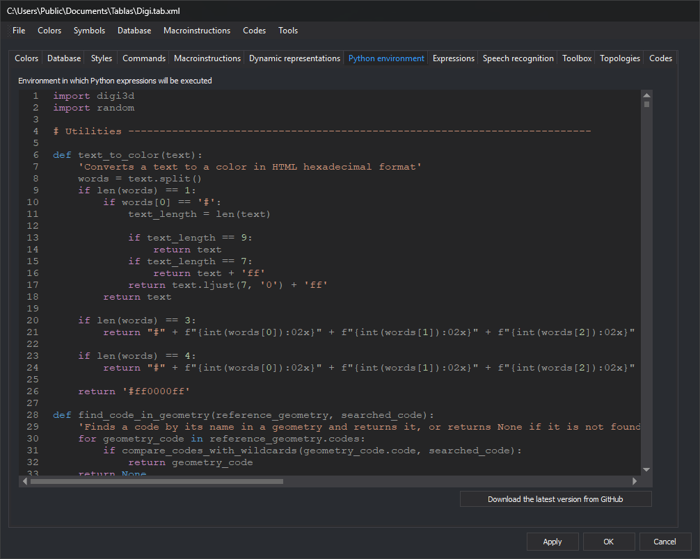

# Python environment
<!-- id: entorno-python -->
<!-- origen: 41d41f9fbc0e32820cd9131176a6b77eb8afbd52 -->

This tab contains Python code Digi3D.AI loads with the code table: [quality control](../../../programacion/python/controles-de-calidad/README.md) functions and helper functions used by the table's Python expressions.

## Fields

* **Environment in which Python expressions will be executed**: Python code editor with line numbers and syntax highlighting.
* **Download the latest version from GitHub**: replace all editor contents with `guiones.py` from [Guiones-Control-Calidad-Python-Digi3D](https://github.com/digi21/Guiones-Control-Calidad-Python-Digi3D), containing Digi21 quality controls. An Internet connection is required.

Save changes in the code table by clicking **Apply** or **OK**.

[Python quality control repository](../../../programacion/python/guiones-control-calidad/README.md) describes the quality controls and dynamic representation rules in `guiones.py`.

To update a code table created with an earlier Digi3D version, see [Update a code table's Python quality controls](../../../usuarios-de-versiones-anteriores/actualizar-guiones-python.md).
