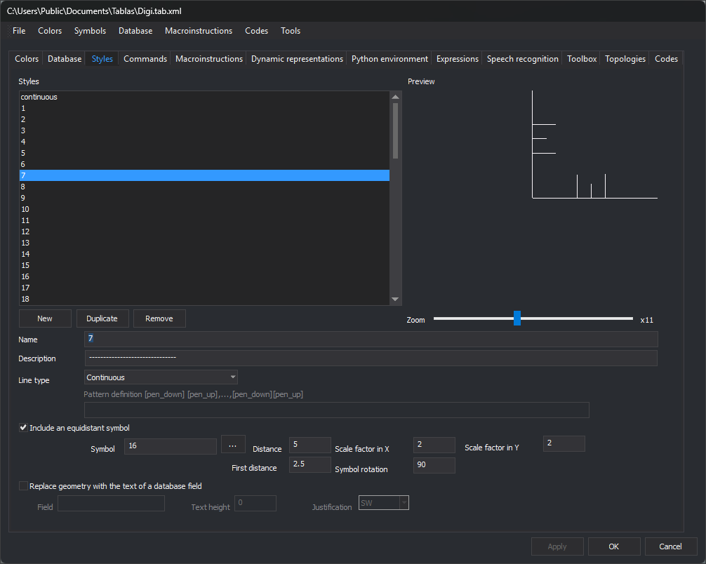
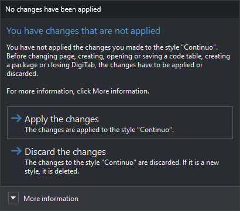

# Styles
<!-- id: estilos -->
<!-- origen: d60d51e2c40140687939ae76f55c243ef9e9f298 -->



This tab configures geometry drawing styles. Each code representation references a style; color and weight belong to the representation, not the style.

## Styles

Code table style list. Selecting a style shows its properties below and its drawing in **Preview**.

* **New**: creates an unapplied **Style*N*** with the first available number, a continuous line and no symbol.
* **Duplicate**: creates an unapplied **Copy of: *name***. Disabled while the selected style has unapplied changes.
* **Remove**: deletes the selected style, except the last. If codes use it, a task dialog lists them and offers the first style as replacement (the second if deleting the first), or lets you choose in [Select style](selecciona-el-estilo.md).

## Preview and Zoom

**Preview** draws the style. **Zoom** changes its scale, with the factor shown to the right.

## Name and Description

* **Name**: style name. Case-insensitive duplicates are forbidden: applying displays a warning and leaves changes unapplied. Renaming updates code representations using the style.
* **Description**: optional description.

## Type of line

How this style draws a line. Does not affect point geometries.

* **Invisible**: no baseline.
* **Continuous**: continuous line.
* **With pattern**: follows **Pattern definition**, enabled only with this option.

### Pattern definition

Values alternating drawn segments (pen down) and gaps (pen up), in millimeters at drawing scale: at 1:1000, 1 equals 1 meter. Separate with spaces or commas. For `---- - ---- - ----`:

```
4 1 1 1
```

* Draw 4 mm.
* Leave 1 mm.
* Draw 1 mm.
* Leave 1 mm.

## Include an equidistant symbol

When enabled, draws symbols along a line or at a point geometry's position. Enables:

* **Symbol**: symbol name. Symbols are `.bin` drawings in the folder under **Tools/Configuration...**, usually `C:\ProgramData\Digi3D.NET\Símbolos`. **...** opens [Select symbol](selecciona-el-simbolo.md), showing symbols and textures there.
* **Distance**: symbol spacing along the line, in millimeters at drawing scale, as with **First distance**. With 0, no symbol is drawn on the line.
* **First distance**: distance from the first vertex to the first symbol.
* **Scale factor in X** and **Scale factor in Y**: horizontal and vertical symbol scale. With 0, no symbol is drawn.
* **Symbol rotation**: clockwise rotation in sexagesimal degrees, relative to each line segment. Point geometries use the point rotation.

> If a symbol is missing, check its folder under **Tools/Configuration...**.

## Replace geometry with the text of a database field

Draws a database record field's value as text instead of the geometry. Enables:

* **Field**: field whose value is drawn.
* **Text height**: text height.
* **Justification**: text point placed at the geometry: **SO**, **O**, **NO**, **N**, **NE**, **E**, **SE**, **S** or **C** (center).

## Apply changes

Changes apply with **Apply** or **OK**. Selecting another style or clicking **New** with unapplied changes asks “Do you want to save the changes?”: **Yes** applies, **No** discards. Switching tabs opens the next dialog.

### Changing pages



Appears with unapplied style changes when switching tabs, clicking **OK** or selecting **New**, **Open...**, **Save**, **Save as...** or a package creation option under [File](../menus/archivo/README.md).

* **Apply the changes**: applies changes. Renaming updates codes using the style. A duplicate name displays a warning and prevents applying. Default button.
* **Discard the changes**: discards changes and clears style selection. A new style is deleted. Esc selects this button.

**More information** explains that style changes affect other pages: for example, style names appear in Codes. Either button continues the tab change or operation.
