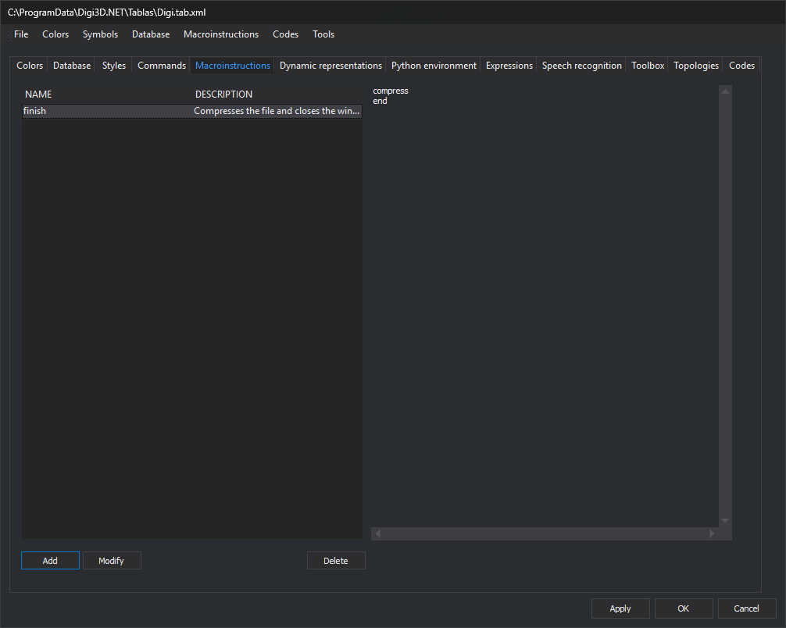

# Macroinstructions
<!-- id: macroinstrucciones-3 -->
<!-- origen: 3a5e031a3fee206cd4e96e231981d0828ec5e378 -->

Store [macroinstructions](/digi3d-ai/referencia/ordenes/formas-de-ejecutar-una-orden/ejecutar-una-orden-desde-la-linea-de-comandos/macroinstrucciones.md) in the code table on this tab. A macroinstruction is a named command list.

## Controls

* **Macroinstruction list**, with **Name** and **Description** columns.
* **Content**: the box on the right shows the selected macroinstruction's commands without allowing edits.
* **Add**: open **New macroinstruction**, requesting **Name** and **Description (optional)**. If that name already exists, ignoring case, display a message and do not add it. Otherwise, open **Code editor** to enter commands, one per line.
* **Modify**: open **Code editor** with the selected macroinstruction's commands. Its name and description remain unchanged.
* **Delete**: delete the selected macroinstruction.

**Modify** and **Delete** are enabled when a row is selected.

## Macroinstructions menu

**Import macroinstructions from folder...** requests a folder and adds one macroinstruction per file whose name starts with `@`. The macroinstruction name is the file name, and its content is the file's lines. Existing names are not checked.

Apply changes to the code table by clicking **Apply** or **OK**.
