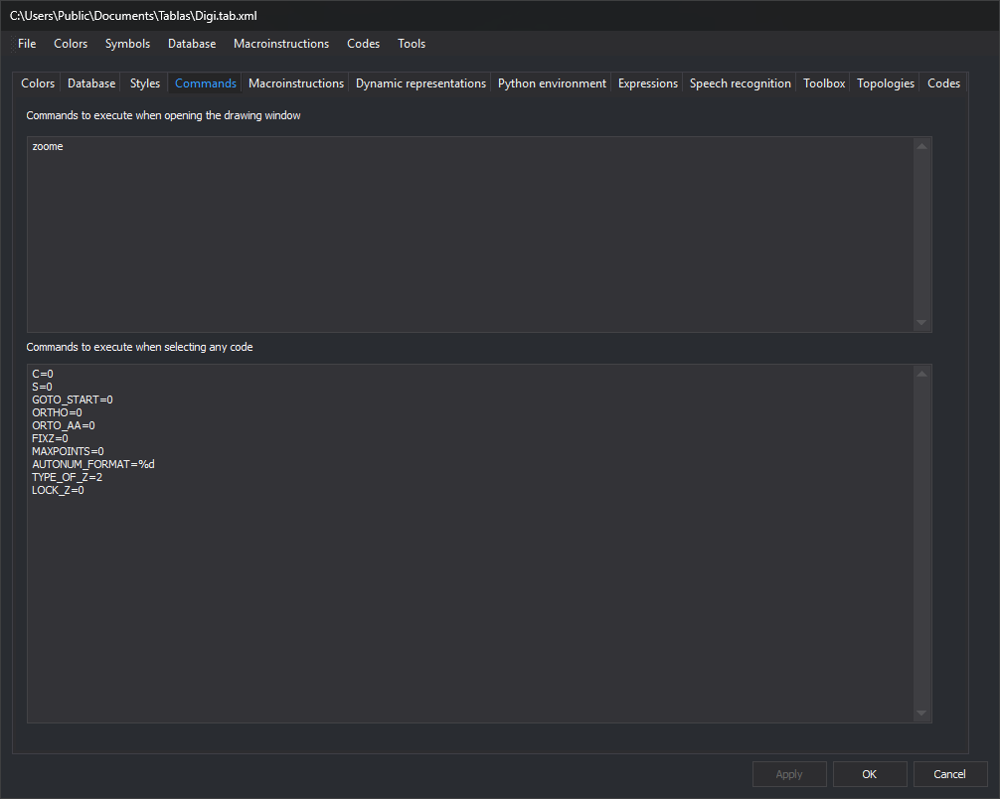

# Commands
<!-- id: ordenes-4 -->
<!-- origen: 28878464b7f251c2a4310d710f17c4f381cb8116 -->



Configure commands that Digi3D.AI [runs automatically](/digi3d-ai/referencia/ordenes/formas-de-ejecutar-una-orden/al-seleccionar-un-codigo.md) in the drawing window with this code table loaded. Each text box accepts one command per line.

## Startup commands

**Commands to execute when opening the drawing window**: commands run when opening a drawing window with this code table.

For example, this zooms to the model extents when the window opens:

```text
zoome
```

## Commands to execute when selecting any code

**Commands to execute when selecting any code**: commands run whenever the active code changes, regardless of code. Code-specific commands use **Command (selecting code)** on [Codes](codigos/propiedades-del-codigo.md).

For example, these disable certain variables when changing code:

```text
C=0
S=0
GOTO_START=0
ORTHO=0
ORTO_AA=0
FIXZ=0
MAXPOINTS=0
AUTONUM_FORMAT=%d
TYPE_OF_Z=2
LOCK_Z=0
```

**Apply** or **OK** applies changes from this tab to the code table.
