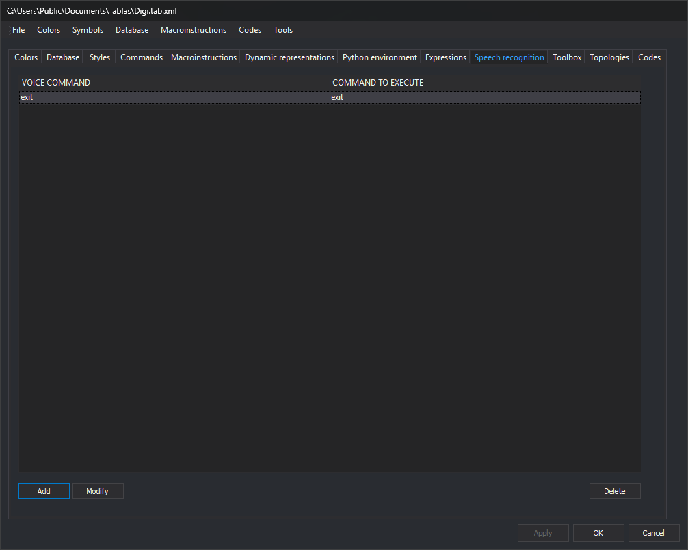

# Speech recognition
<!-- id: reconocimiento-de-voz -->
<!-- origen: 02dc867bdcc4f843367527dcb760e270b1beda94 -->

This tab configures phrases associated with commands. When Windows speech recognition recognizes a phrase, Digi3D.AI runs its command. Speech recognition is active only with [SPEECH\_RECOGNITION](/digi3d-ai/referencia/ventana-de-dibujo/variables/r/reconocer-voz.md) enabled.

## Controls

* **Command list**, with **Voice command** and **Command to execute** columns.
* **Add**: opens **Voice command**, with two fields:
  * **Voice commands (separated by semicolons;)**: one or more phrases triggering the command, separated by `;`.
  * **Command to execute**: command run when any phrase is recognized.
* **Modify**: opens **Voice command** with the selected entry's data.
* **Delete**: deletes the selected entry.

**Modify** and **Delete** are enabled when an entry is selected.

Changes apply to the code table with **Apply** or **OK**.
